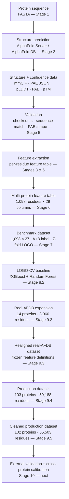
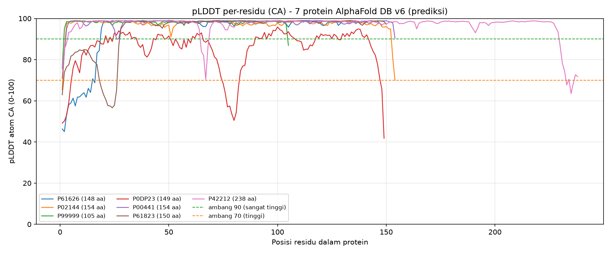
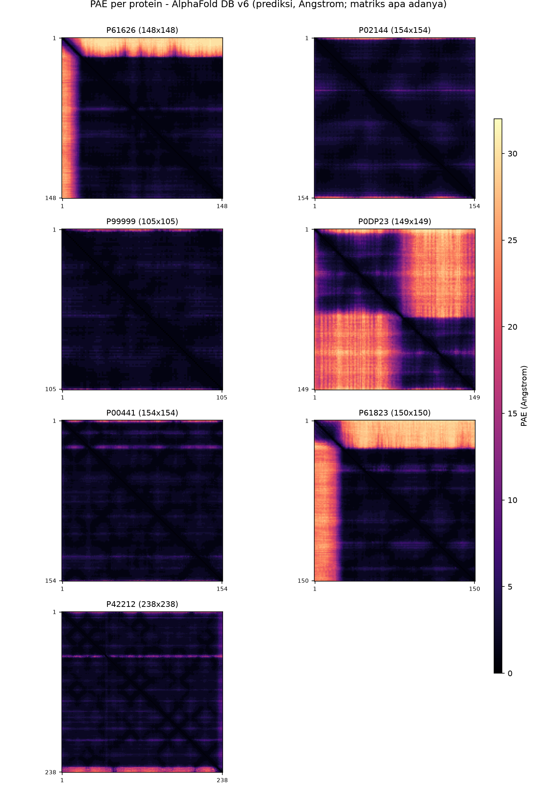

<div align="center">
  
</div>

<div align="center">
  <h1>AI + Biotech — Protein Analysis Pipeline</h1>
  <p>From AlphaFold structure predictions to a validated, reproducible residue-level dataset —<br/>
  a small, test-driven pipeline for computational structural biology and AI4Bio.</p>
</div>

<p align="center">
  
  
  
</p>

---

## About the Project

This is an **early-stage AI for Biotechnology (AI4Bio) research project** in computational
biology, currently focused on **protein structure analysis, residue-level feature extraction,
dataset construction, and validation**. It builds a **data pipeline** that starts from protein
sequences, uses AlphaFold predictions (AlphaFold Server for a single reference protein, and the
AlphaFold Database for a curated 7-protein set), and ends with a **validated, residue-level
feature dataset**: the foundation for future AI-assisted biological research. The stack is
deliberately small and inspectable — Python, Biopython, pandas, NumPy, matplotlib.

Every stage is gated by integrity tests that **recompute critical values from the raw prediction
files** instead of trusting derived outputs, and every output is documented — column definitions,
units, and exclusions included. The goal is a pipeline that is correct, reproducible, and honest
about what it does and does not show.

**Scope, stated plainly:** this is currently a *protein structure analysis, dataset engineering,
and benchmark-baseline* project. It is **not** a finished drug-discovery system: there is no
molecular docking, no molecular dynamics, no compound screening, and no wet-lab validation. A
reproducible ML baseline now exists (Stage 8.2, leave-one-protein-out cross-validation), but it is
a **benchmark for comparison**, not evidence of biological generalization. Two independently
audited expansions (Stage 9.2 and its Stage 9.3 realignment) cover 14 proteins / 3,960 residues
built from real AlphaFold DB structures. Stage 9.3 uses the frozen Stage 3/8.2 feature
definitions; neither expansion replaces the frozen Stage 8.2 benchmark. **Stage 9.4** scales the
audited dataset to **103 proteins / 59,188 residues**, with XGBoost LOGO-CV reproduced exactly.
**Stage 9.5** excludes P11532 — whose AFDB entry is a non-canonical isoform — producing a fully
complete **102-protein / 55,503-residue** dataset with no missing structural values and re-trained
LOGO-CV metrics. These remain data-engineering milestones, not external validation, and the
pooled ROC increase is not a like-for-like measure of generalization.

## Research Objectives

The project investigates how protein structural information can be transformed into **reliable,
machine-readable features** for future computational biology and AI research. The premise is
deliberately bottom-up: before any model is trained or any result is reported, the data itself —
its provenance, column definitions, units, and integrity — must be trustworthy.

**Established work.** Protein sequence and structure analysis of a reference protein,
residue-level feature extraction with fully documented definitions and units, controlled
construction of a 7-protein dataset from the AlphaFold Database, integrity validation
(checksums, sequence matching, and recomputation of derived values from the raw prediction
files), plus a frozen Stage 7 benchmark and a reproduced Stage 8.2 leave-one-protein-out
baseline. Stage 9.2 adds an independently audited 14-protein / 3,960-residue expansion built
from real AlphaFold DB CIF/PAE files, with A+B labels verified against UniProt. Stage 9.3
rebuilds that expansion with the frozen Stage 3/8.2 feature definitions and re-audits every
row against fresh AFDB/UniProt downloads. Stage 9.4 scales the audited dataset to 103
proteins / 59,188 residues, verifies all sequence features and labels against UniProt, and
reproduces the XGBoost baseline exactly. Stage 9.5 removes the misaligned P11532 isoform,
producing a complete 102-protein / 55,503-residue dataset with zero missing structural values
and re-trained LOGO-CV metrics (see [Current Results](#current-results)).

**Future goals.** The benchmark dataset and a baseline are now in place, and the Stage 9.2
expansion, its Stage 9.3 realignment, the Stage 9.4 103-protein scaling, and the Stage 9.5
cleansing have been audited. P11532 is excluded in Stage 9.5; the project now aims to run
external validation on proteins not used for any design decision, test probability calibration
across proteins, and determine whether any signal generalizes beyond the current proteins. No
broad biological hypothesis or generalizable
predictive model exists yet. See [Limitations and Future Work](#limitations-and-future-work).

## Research FAQ

**What is this project about?**
An early-stage AI4Bio / computational biology research project. It builds and validates a data
pipeline that turns protein sequences into AlphaFold-predicted structures and then into a
machine-readable, residue-level feature dataset. The frozen Stage 7 benchmark contains 7
proteins / 1,098 residues; the audited Stage 9.2 expansion contains 14 proteins / 3,960
residues; Stage 9.4 scales to 103 proteins / 59,188 residues, and Stage 9.5 cleans that to
102 proteins / 55,503 residues by excluding P11532. The project also maintains a frozen
benchmark with a binary functional-site label and a reproducible leave-one-protein-out ML
baseline (Stage 8.2).

**What scientific problem does it aim to address?**
How protein structural information — including the confidence measures that come with predicted
structures (pLDDT, PAE) — can be turned into reliable, well-documented, machine-readable
features suitable for AI research. The current work addresses *data quality and reproducibility*;
a specific biological hypothesis is not yet part of the project.

**What has been completed so far?**
Stages 1–9.5: sequence analysis, structure analysis (ubiquitin reference), residue-level feature
extraction (ubiquitin, 76 × 28), dataset planning (7 proteins, 6 functional categories), the
controlled AlphaFold DB download and validation (14 v6 files, checksums and sequences verified),
and the multi-protein dataset (1,098 residues × 29 columns). All four extraction test suites pass
— 72/72 checks (20 + 12 + 16 + 24). Stage 7 adds a frozen benchmark dataset (1,098 × 27) with
UniProt Active site + Binding site labels (46 positives) and seven leave-one-protein-out folds.
Stage 8.2 adds a reproducible XGBoost / Random Forest baseline; XGBoost matches the delivered
summary exactly, and Random Forest agrees within a small tolerance. Details:
[`docs/BENCHMARK_DATASET_LOCK.md`](docs/BENCHMARK_DATASET_LOCK.md).

**Stage 9.2** scales the data to **14 proteins / 3,960 residues / 129 positives** using real
AlphaFold DB CIF and PAE files. An independent audit recomputed every structural feature from
the raw files (pLDDT, PAE row/column, atom count), verified sequences and checksums 14/14, and
confirmed the A+B labels against live UniProt annotations with zero mismatches. The LOGO-CV
metrics reproduce (XGBoost exactly; Random Forest within ≤0.0011). Two caveats are documented:
`pae_local_mean_k10` is computed with a ±5 window including the residue itself (not the frozen
±10 definition), and histidine is classified as `aromatic` rather than `basic`. Stage 9.2 is
therefore a separate dataset and is **not directly comparable** to the frozen Stage 8.2
benchmark. See [`docs/PROJECT_STATUS.md`](docs/PROJECT_STATUS.md) §16 for the full audit.

**Stage 9.3** realigns that expansion to the frozen Stage 3/8.2 definitions:
`pae_local_mean_k10` now uses `|i-j| ≤ 10, j ≠ i`, and histidine is classified `basic`. A fresh
independent audit — using new AFDB v6 downloads rather than the Stage 9.2 audit files — found
zero feature or label mismatches across all 3,960 rows; `target_y` is identical to Stage 9.2,
and only the PAE k10 column (all rows) and the histidine category (108 rows) changed. Median,
pooled, and gain LOGO-CV metrics reproduce (XGB median ROC 0.7264 / PR 0.1684, pooled 0.6411 /
0.0858; RF median 0.7518 / 0.1763, pooled 0.6575 / 0.0912). The delivered PR IQRs (0.1348 XGB,
0.2259 RF) do **not** reproduce — recomputed values are 0.1796 and 0.2461. See
[`docs/PROJECT_STATUS.md`](docs/PROJECT_STATUS.md) §17.

**Stage 9.4** scales the audited dataset to **103 proteins / 59,188 residues / 959 positives
(1.62%)**. An independent audit re-downloaded 206 AFDB CIF/PAE files (103 proteins, ~175 MB),
103 AFDB API responses, and 103 UniProt records: all sequence-derived features and labels match
59,188/59,188 rows, and all structural features match exactly on the 56,028 modeled rows.
XGBoost LOGO-CV reproduces exactly (median ROC 0.7359; pooled ROC 0.7575, PR 0.0606, gain
3.74x). Random Forest reproduces the pooled ROC 0.7471 but **not** the claimed median ROC
0.7397 or pooled PR 0.0592 (reproduced: 0.7339 and 0.0573). Two caveats are recorded: P11532
uses AFDB isoform `AF-P11532-9-F1` (525 aa), which differs from the canonical sequence at
496/525 positions; 3,160 P11532 rows have no structural data and all four of its positives lack
structural features. Also, the pooled ROC rise from Stage 8.2 (0.5368) to Stage 9.4 (0.7575) is
not a like-for-like comparison — within-protein diagnostics are lower (z-scored pooled ROC
0.6876) and the median per-protein ROC improves only from 0.7185 to 0.7359. See
[`docs/PROJECT_STATUS.md`](docs/PROJECT_STATUS.md) §18 for the full audit.

**Stage 9.5** cleans the production dataset by excluding **P11532** entirely: its AFDB entry is
a 525-aa isoform that differs from the canonical sequence at 496/525 positions, so its rows
cannot be aligned. The cleaned dataset
([`results/dataset/production_dataset_100_cleaned.csv`](results/dataset/production_dataset_100_cleaned.csv))
contains **102 proteins / 55,503 residues / 955 positives (1.72%)**, with **zero empty cells,
zero unmodeled rows**, 24 zero-positive proteins, and 78 evaluable LOGO folds. LOGO-CV was
re-run from scratch: XGBoost median ROC 0.7371 / PR 0.0673, pooled ROC 0.7476 / PR 0.0640
(gain 3.72x); Random Forest median ROC 0.7330 / PR 0.0731, pooled ROC 0.7476 / PR 0.0608
(gain 3.53x). Removing P11532 **lowers** XGB pooled ROC from 0.7575 to 0.7476 because those
rows were inflating the pooled score, while pooled PR rises from 0.0606 to 0.0640 and the
median per-protein ROC moves only from 0.7359 to 0.7371. Within-protein z-scored ROC remains
0.6877 (XGB) / 0.6891 (RF). Cleansing improves validity, not generalization. See
[`docs/PROJECT_STATUS.md`](docs/PROJECT_STATUS.md) §19.

**Is this already an AI model for drug discovery?**
No. There is no generalizable trained model for function prediction, no molecular docking, no
molecular dynamics, no compound screening, and no wet-lab validation. AlphaFold itself is a
deep-learning system, and its predictions are the data this project works with — but the
project's own outputs are validated datasets, a benchmark, and a weak baseline, not
drug-discovery results.

**Why might HPC or powerful GPUs be useful?**
Not for the current pipeline — it is small and runs on a standard machine without a GPU. HPC or
GPU resources could become relevant only if the project later moves to larger-scale protein
representation learning or model training and evaluation. Whether such hardware is warranted
depends on dataset size, model architecture, memory requirements, and experimental design — more
compute does not by itself produce better science. See
[Computing Resources and Research Support](#computing-resources-and-research-support).

**What are the next research goals?**
P11532 has now been excluded in Stage 9.5, yielding a clean 102-protein / 55,503-residue
dataset with no missing structural values. Use that as the scaling artifact while keeping the
same invariant feature definition and A+B label policy. Run external validation on proteins not
used for feature selection; test probability calibration across proteins; report within-protein
and median per-protein metrics alongside pooled ROC; and only then evaluate whether a broader
biological question (e.g., GO terms or EC numbers) is supportable.

**Is the project open to academic collaboration?**
Yes. The pipeline, dataset, schema, and test suites are public and reproducible, and the project
welcomes academic collaboration, mentorship, and discussions about research direction or
computing support. Reach out through the repository's GitHub page (e.g., by opening an issue).

## Research Pipeline



Each arrow is a checkpoint, not just a hand-off: the structure data is validated against
checksums and UniProt sequences before extraction, extraction follows a documented schema, and
the resulting dataset has its own test suite. Full stage logs live in
[`docs/`](docs/) (written in Indonesian, the project's working language).

## Current Results

Pipeline status across all stages — as of the latest verified runs:

| Stage | Output | Verification |
|---|---|---|
| 1 | Sequence analysis — ubiquitin, 76 aa | reference input for Stages 2–3 |
| 2 | Structure analysis — ubiquitin (AlphaFold Server), pLDDT / pTM | analysis artifacts in `results/` |
| 3 | Residue-level features — 76 residues × 28 columns | **20/20 tests PASS** |
| 4 | Dataset manifest — 7 candidate proteins, 6 functional categories | **12/12 tests PASS** |
| 5 | Controlled download + validation — 14 files (7 CIF + 7 PAE JSON, AFDB v6) | **16/16 tests PASS** |
| 6 | Multi-protein dataset — 1,098 residues × 29 columns | **24/24 tests PASS** |
| 7 | Benchmark dataset — 1,098 × 27, A+B label, 7-fold LOGO | **LOCKED** — SHA256 + audit 7/7; see lock doc |
| 8.2 | LOGO-CV baseline — XGBoost + Random Forest | **VERIFIED** — XGB exact; RF within tolerance |
| 9.2 | Real-AFDB expansion — 3,960 × 12, 14 proteins, A+B label, 14-fold LOGO | **AUDITED** — features/labels 100% match AFDB + UniProt; metrics reproduced; 2 feature-definition caveats |
| 9.3 | Realigned real-AFDB dataset — 3,960 × 12, frozen feature definitions | **AUDITED** — features/labels 100% match fresh AFDB + UniProt; median/pooled/gain reproduced; PR-IQR discrepancy documented |
| 9.4 | Production dataset — 59,188 × 12, 103 proteins, 959 positives, 79 evaluable folds | **AUDITED** — sequence features/labels 59,188/59,188 and structural features 56,028/56,028 match; XGB exact; RF pooled ROC exact, median/pooled PR not; P11532 isoform caveat |
| 9.5 | Cleaned production dataset — 55,503 × 12, 102 proteins, 955 positives, 78 evaluable folds | **AUDITED** — P11532 (3,685 rows) excluded; 0 empty/unmodeled cells; exact row-for-row derivation; XGB median ROC 0.7371 / pooled 0.7476; RF 0.7330 / 0.7476 |

**The multi-protein dataset** (`results/dataset/multi_protein_residue_features.csv`) contains
**1,098 residue rows × 29 columns**: 3 protein identifier columns (`protein_id`,
`uniprot_accession`, `afdb_id`) and 26 numeric/structural feature columns — one row per residue,
built from the frozen AlphaFold DB dataset.

| Accession | Protein | Organism | Residues | Mean pLDDT | Mean PAE (Å) |
|---|---|---|---|---|---|
| P61626 | Lysozyme C | *Homo sapiens* | 148 | 94.07 | 5.96 |
| P02144 | Myoglobin | *Homo sapiens* | 154 | 97.18 | 2.67 |
| P99999 | Cytochrome c | *Homo sapiens* | 105 | 97.93 | 2.06 |
| P0DP23 | Calmodulin-1 | *Homo sapiens* | 149 | 85.24 | 13.28 |
| P00441 | Superoxide dismutase [Cu-Zn] | *Homo sapiens* | 154 | 97.93 | 2.18 |
| P61823 | Ribonuclease pancreatic | *Bos taurus* | 150 | 94.04 | 8.16 |
| P42212 | Green fluorescent protein | *Aequorea victoria* | 238 | 96.64 | 2.90 |

All 7 proteins passed per-protein validation. Summary values above are taken from
`results/dataset/multi_protein_summary.csv`; column definitions, units, and derivation rules are
in [`multi_protein_structure_features.json`](results/dataset/multi_protein_structure_features.json).

**The benchmark dataset** ([`results/dataset/stage7_processed_dataset.csv`](results/dataset/stage7_processed_dataset.csv))
is frozen at **1,098 × 27**, with `target_y` (UniProt Active site + Binding site; 46 positives,
4.19%) and seven leave-one-protein-out folds. It is byte-locked by SHA256; see
[`docs/BENCHMARK_DATASET_LOCK.md`](docs/BENCHMARK_DATASET_LOCK.md) for the schema, fold map,
freeze policy, and official Stage 8.2 metrics.

**The Stage 9.2 expansion** ([`results/dataset/stage9_processed_dataset.csv`](results/dataset/stage9_processed_dataset.csv))
contains **3,960 residue rows × 12 columns** from **14 proteins**, with the same strict A+B
label policy (**129 positives, 3.26%**) and 14 leave-one-protein-out folds (13 evaluable;
insulin P01308 has zero positives). SHA256:
`58e55a293b66c13dd4ca4437f1d268f69fc212c93376f58488a692998255e10c`.

| Model | Median ROC-AUC (IQR) | Median PR-AUC (IQR) | Pooled ROC-AUC | Pooled PR-AUC |
|---|---:|---:|---:|---:|
| XGBoost | **0.7092** (0.1580) | **0.1509** (0.1260) | **0.6484** | **0.1022** |
| Random Forest | **0.7305** (0.1423) | **0.1852** (0.2622) | **0.6523** | **0.0996** |

**Independent audit.** Every structural feature was recomputed from freshly downloaded AFDB
v6 CIF/PAE files: `plddt_ca`, `pae_mean_row`, `pae_mean_col`, `n_atoms`, hydropathy, and charge
match 3,960/3,960 rows; sequences and checksums match 14/14; and `target_y` matches live
UniProt A+B annotations with zero mismatches. The metrics reproduce (XGBoost exactly;
Random Forest within ≤0.0011). Two deviations from the frozen Stage 3/8.2 definitions are
recorded rather than silently corrected: `pae_local_mean_k10` uses a ±5 window **including**
the residue itself (not ±10 excluding it), and histidine is classified as `aromatic` rather
than `basic`. P00720 (Endolysin) has no AlphaFold DB entry (HTTP 404), so the processed dataset
has 14 proteins while the 15-protein metadata file includes it. Stage 9.2 is therefore
**audited but not locked**, and its metrics are **not directly comparable** to Stage 8.2.
Full evidence: [`docs/PROJECT_STATUS.md`](docs/PROJECT_STATUS.md) §16.

**The Stage 9.3 realignment** ([`results/dataset/stage93_realigned_dataset.csv`](results/dataset/stage93_realigned_dataset.csv))
contains the same **3,960 residue rows × 12 columns** from **14 proteins** and **129 positives
(3.26%)**, rebuilt with the frozen Stage 3/8.2 definitions: `pae_local_mean_k10 = mean(PAE[i,j]
for |i-j| ≤ 10, j ≠ i)` and histidine = `basic`. An independent audit re-downloaded all 28 AFDB
v6 CIF/PAE files and UniProt records from scratch, then matched every row: **zero feature or
label mismatches**, sequences and checksums 14/14, and `target_y` identical to Stage 9.2. Only
`pae_local_mean_k10` (all 3,960 rows) and `amino_acid_type` (108 histidines) changed. SHA256:
`6f0357858638c57630e0276fb8e46339a16f001e54005dba34adb5b5e3f37f5a`.

| Model | Median ROC-AUC (IQR) | Median PR-AUC (IQR) | Pooled ROC-AUC | Pooled PR-AUC |
|---|---:|---:|---:|---:|
| XGBoost | **0.7264** (0.0974) | **0.1684** (0.1796) | **0.6411** | **0.0858** |
| Random Forest | **0.7518** (0.1531) | **0.1763** (0.2461) | **0.6575** | **0.0912** |

Median, pooled, and gain values reproduce the delivered summary (RF pooled ROC 0.6575 vs. the
claimed 0.6577, within the recorded tolerance). The delivered **PR IQRs do not reproduce**:
0.1348/0.2259 claimed vs. 0.1796/0.2461 recomputed with every standard quantile method; the
table above uses the recomputed values. Stage 9.3 uses the frozen feature definitions but the
same 14 proteins as Stage 9.2, so it is a corrected expansion — not new evidence and not a
replacement for the frozen Stage 8.2 benchmark. Full evidence:
[`docs/PROJECT_STATUS.md`](docs/PROJECT_STATUS.md) §17.

**The Stage 9.4 production dataset** ([`results/dataset/production_dataset_100_realigned.csv`](results/dataset/production_dataset_100_realigned.csv))
contains **59,188 residue rows × 12 columns** from **103 proteins**, with **959 positives
(1.62%)**, **24 zero-positive proteins**, and **79 evaluable LOGO folds**. It is LF-terminated
(0 CR bytes) and 4,619,447 bytes. SHA256:
`8be323f64d1b5f8dbcfff743d378392bafc72e944f051cac5c835f6f54b1bde1`.

| Model | Median ROC-AUC (IQR) | Median PR-AUC (IQR) | Pooled ROC-AUC | Pooled PR-AUC (gain) |
|---|---:|---:|---:|---:|
| XGBoost | **0.7359** (0.2299) | **0.0656** (0.1025) | **0.7575** | **0.0606** (3.74x) |
| Random Forest | **0.7339** (0.2029) | **0.0762** (0.1430) | **0.7471** | **0.0573** (3.53x) |

**Independent audit.** The audit re-downloaded 206 AFDB v6 CIF/PAE files (103 proteins,
~175 MB), 103 AFDB API responses, and 103 UniProt records. All sequence-derived features and
labels match **59,188/59,188** rows, and all structural features match exactly on the **56,028**
modeled rows; 102/103 proteins are fully clean. XGBoost reproduces every claimed metric exactly.
Random Forest reproduces pooled ROC **0.7471** exactly, but the claimed median ROC 0.7397 and
pooled PR 0.0592 do **not** reproduce (0.7339 and 0.0573); no tested RF configuration
reproduces 0.7397 exactly, and the configuration that matches pooled ROC yields 0.7339.

**Two caveats.** (1) **P11532** uses AFDB isoform `AF-P11532-9-F1` (525 aa), because the API
returns 14 isoforms and no canonical 3,685-aa entry. The isoform differs from the canonical
sequence at 496/525 positions, so its 525 modeled rows are misaligned; the other 3,160 P11532
rows have no structural data, and all four of its positives lack structural features. The
protein is excluded in Stage 9.5 below and should be rebuilt before Stage 9.4 is treated as a
benchmark. (2) The
**pooled ROC increase** from Stage 8.2 (0.5368) to Stage 9.4 (0.7575) is not a like-for-like
comparison: the datasets, prevalence (4.19% vs. 1.62%), and fold counts differ, and pooled ROC
is inflated by between-protein score ordering. Within-protein z-scored pooled ROC is 0.6876
(rank-normalized 0.6847), between-protein AUC is 0.7922, and the median per-protein ROC rises
only from 0.7185 to 0.7359. Absolute pooled PR falls from 0.0916 to 0.0606; the 3.74x gain
rises partly because prevalence is lower. Stage 9.4 is a data-engineering and reproducibility
milestone, **not** evidence of biological generalization. Full evidence:
[`docs/PROJECT_STATUS.md`](docs/PROJECT_STATUS.md) §18.

**The Stage 9.5 cleaned dataset** ([`results/dataset/production_dataset_100_cleaned.csv`](results/dataset/production_dataset_100_cleaned.csv))
contains **55,503 residue rows × 12 columns** from **102 proteins**, with **955 positives
(1.72%)**, **24 zero-positive proteins**, and **78 evaluable LOGO folds**. It is derived by
removing every P11532 row (3,685 rows; 4 positives) from the audited Stage 9.4 file and
altering nothing else: a row-for-row comparison confirms the output is exactly the Stage 9.4
header plus all rows whose `uniprot_id` is not P11532. The result has **zero empty cells,
zero `n_atoms = 0` rows, zero duplicate positions, and zero numbering gaps**. It is
LF-terminated (0 CR bytes) and 4,457,124 bytes. SHA256:
`e47b3635a7e904107094afde02a1ece656e25491c8721865501b6a76562b05a3`.

| Model | Median ROC-AUC (IQR) | Median PR-AUC (IQR) | Pooled ROC-AUC | Pooled PR-AUC (gain) |
|---|---:|---:|---:|---:|
| XGBoost | **0.7371** (0.2300) | **0.0673** (0.1070) | **0.7476** | **0.0640** (3.72x) |
| Random Forest | **0.7330** (0.2096) | **0.0731** (0.1250) | **0.7476** | **0.0608** (3.53x) |

**Impact of cleansing.** These metrics come from a full retrain on the 102-protein dataset,
not from dropping P11532 rows out of the Stage 9.4 out-of-fold predictions. XGBoost pooled
ROC falls from 0.7575 to 0.7476 (−0.0099), while pooled PR rises from 0.0606 to 0.0640
(+0.0034) and median per-protein ROC moves only from 0.7359 to 0.7371 (+0.0012). The fall is
attributable to removing P11532's rows from evaluation: re-scoring the Stage 9.4 OOF
predictions on the same 102 proteins gives 0.7451, and retraining without P11532 slightly
improves that to 0.7476. Random Forest is essentially unchanged (pooled ROC 0.7471 → 0.7476,
pooled PR 0.0573 → 0.0608, median ROC 0.7339 → 0.7330). Within-protein z-scored pooled ROC
is 0.6877 (XGB) / 0.6891 (RF), still well below pooled ROC; between-protein AUC is 0.7851 /
0.7824. Cleansing therefore improves dataset validity but does **not** improve biological
discrimination or establish generalization. Full evidence:
[`docs/PROJECT_STATUS.md`](docs/PROJECT_STATUS.md) §19.

**Verification suites** (all measured on freshly generated outputs; each script exits `0` only if
every check passes):

| Suite | Scope | Result |
|---|---|---|
| `src/test_protein_features.py` | Stage 3 — ubiquitin table vs. raw predictions | 20/20 PASS |
| `src/test_dataset_manifest.py` | Stage 4 — manifest structure & completeness | 12/12 PASS |
| `src/test_afdb_download.py` | Stage 5 — file integrity, checksums, metadata | 16/16 PASS |
| `src/test_multi_protein_features.py` | Stage 6 — recomputation from raw files; reproducibility | 24/24 PASS |

**Current status:** Stages 1–9.5 are complete. A frozen Stage 8.2 benchmark and a reproducible
ML baseline exist, alongside an independently audited 14-protein Stage 9.2 expansion, its Stage
9.3 realignment to the frozen feature definitions, the 103-protein Stage 9.4 production
dataset, and the cleaned 102-protein Stage 9.5 dataset. XGBoost reproduces exactly at every
stage; Stage 9.4 Random Forest reproduces pooled ROC but not median ROC or pooled PR (Stage
9.5 metrics are computed directly, with no external claim to reproduce). P11532 is excluded in
Stage 9.5, leaving zero missing structural values. No biological conclusions or generalization
claims are drawn from any expansion; the next gate is external validation and cross-protein
calibration.

## Dataset Visualizations

Generated by `src/extract_multi_protein_features.py`, from the frozen AlphaFold DB dataset:

<div align="center">
  
  <br/>
  <em>pLDDT per residue (CA atom) for all 7 proteins — dashed reference bands at 90 and 70.</em>
</div>

<div align="center">
  
  <br/>
  <em>PAE matrices, one per protein (Å) — darker regions indicate lower predicted alignment error.</em>
</div>

*Chart labels follow the project's working language (Indonesian).*

## Repository Structure

```
ai-biotech/
├── data/
│   ├── ubiquitin_sequence.fasta             # Stage 1 input — ubiquitin, 76 aa
│   ├── alphafold_db/
│   │   ├── raw/                             # frozen dataset: 7 CIF models + 7 PAE JSON (v6)
│   │   └── metadata/                        # candidate list, API snapshots, checksums, download log
│   └── alphafold_downloads/                 # AlphaFold Server example outputs (local only, git-ignored)
├── structures/
│   └── ubiquitin_alphafold.cif              # Stage 2–3 reference structure
├── src/
│   ├── analyze_protein.py                   # Stage 1–2: sequence + structure analysis
│   ├── extract_protein_features.py          # Stage 3: residue-level extraction (ubiquitin)
│   ├── prepare_dataset.py                   # Stage 4: dataset manifest (7 candidate proteins)
│   ├── download_afdb_dataset.py             # Stage 5: controlled AlphaFold DB download
│   ├── validate_afdb_dataset.py             # Stage 5: offline integrity validation
│   ├── extract_multi_protein_features.py    # Stage 6: multi-protein feature extraction
│   └── test_*.py                            # integrity test suites (Stages 3–6)
├── results/
│   ├── dataset/                             # Stage 4–9.5 outputs (CSV · JSON · PNG)
│   │   ├── stage7_processed_dataset.csv     # frozen benchmark (1,098 × 27, SHA256-locked)
│   │   ├── production_dataset_100_realigned.csv  # Stage 9.4 (59,188 × 12, 103 proteins)
│   │   └── production_dataset_100_cleaned.csv    # Stage 9.5 (55,503 × 12, 102 proteins, P11532 excluded)
│   └── ...                                  # Stage 1–3 outputs (JSON · CSV · PNG)
├── docs/
│   ├── DATASET_PLAN.md                      # dataset source plan & candidate selection
│   ├── PROJECT_STATUS.md                    # single source of truth for project status
│   ├── BENCHMARK_DATASET_LOCK.md            # benchmark contract & Stage 8.2 metrics
│   ├── TAHAP_5_AFDB_DOWNLOAD_REPORT.md      # Stage 5 download & integrity report
│   ├── TAHAP_6_MULTI_PROTEIN_FEATURE_REPORT.md  # Stage 6 extraction report & schema
│   └── assets/banner.svg                    # README hero banner
├── notebooks/
│   └── 01_first_protein_analysis.ipynb      # concept notebook (amino acids → pLDDT/PAE/pTM)
├── requirements.txt
└── README.md
```

> `data/alphafold_downloads/` holds the AlphaFold Server example outputs used in Stages 2–3.
> It is kept local (see `.gitignore`) because the public AlphaFold DB files are the tracked
> dataset; the downloadable entry point for the dataset is `src/download_afdb_dataset.py`.

## Getting Started

**Prerequisites:** Python **3.12.10**, `git`, and network access only for the optional download
step (the dataset is already committed).

**Setup** — create the virtual environment and install dependencies:

```bash
python -m venv .venv

# Windows
.venv\Scripts\activate
# macOS / Linux
source .venv/bin/activate

pip install -r requirements.txt
```

**Sequence & structure analysis** (works directly from a fresh clone):

```bash
python src/analyze_protein.py --fasta data/ubiquitin_sequence.fasta   # sequence only
python src/analyze_protein.py                                         # scan structures/ folder
python src/analyze_protein.py structures/ubiquitin_alphafold.cif      # one structure file
python src/analyze_protein.py --help                                  # all options
```

**Dataset pipeline** (Stages 4–6; works from a fresh clone — the raw AFDB files are committed):

```bash
# Stage 4 — build the dataset manifest (no downloads)
python src/prepare_dataset.py
python src/test_dataset_manifest.py

# Stage 5 — controlled download (already run) + offline validation & integrity tests
python src/download_afdb_dataset.py
python src/validate_afdb_dataset.py
python src/test_afdb_download.py

# Stage 6 — multi-protein feature extraction & tests
python src/extract_multi_protein_features.py
python src/test_multi_protein_features.py
```

**Stage 3 (ubiquitin)** additionally requires the AlphaFold Server example outputs in
`data/alphafold_downloads/` — not committed to the repository:

```bash
python src/extract_protein_features.py
python src/test_protein_features.py
```

All test scripts **exit `0` only when every check passes**, and all outputs are written to
`results/` (dataset stage outputs go to `results/dataset/`).

## Scientific Notes

**pLDDT (per-residue confidence, 0–100).** The model's estimated confidence in the **local**
structure around each residue. As a rough guide: above 90 very high, 70–90 confident, 50–70 low,
below 50 very low. It should be read per region — a single global average hides disordered or
uncertain segments, which is exactly why the dataset stores per-residue values.

**PAE (Predicted Alignment Error, Å).** An N×N matrix estimating the expected position error of
residue *i* if the structure is aligned on residue *j*. Low PAE between two residues means the
model is confident about their **relative placement** — useful for judging domain packing. The
dataset also summarizes PAE per residue with explicit aggregation rules (`pae_mean_row`,
`pae_mean_col`, `pae_local_mean_k10`), documented in the schema JSON.

**Two data sources, intentionally separated.** The *ubiquitin example* (AlphaFold Server,
Stages 2–3) is a single reference protein used to learn and validate the pipeline; its full
outputs include a `contact_probs` matrix. It is a learning artifact, and it is **not** used as
ML training data. The *multi-protein dataset* (AlphaFold DB, Stages 4–6) consists of 7
single-chain v6 models downloaded through the official API, checksummed, and frozen before any
extraction.

**Why two columns are missing from the multi-protein table.** Stage 3's 28-column schema includes
`contact_prob_sum` and `n_high_conf_contacts`, which depend on the `contact_probs` matrix. That
matrix is not part of the public AlphaFold DB downloads (which provide CIF + PAE JSON only), so
both columns are **excluded** — not imputed, approximated, or silently redefined — and the
exclusion is documented explicitly in
[`multi_protein_structure_features.json`](results/dataset/multi_protein_structure_features.json).
The remaining 26 features are unchanged from the Stage 3 definitions.

**Predictions are not experimental validation.** pLDDT, PAE, and pTM measure the model's internal
confidence — not biological truth. A high-confidence prediction can still be wrong, and verifying
a structure requires real experiments (X-ray crystallography, NMR, cryo-EM, and so on). Nothing
in this repository should be read as experimentally validated structure or function.

## Limitations and Future Work

### Completed (Stages 1–9.5)

Protein data retrieval (AlphaFold Server reference structure; 7 curated AlphaFold DB entries),
structure validation (checksums, sequence matching, PAE shape), residue-level feature extraction
(ubiquitin 76 × 28; multi-protein 1,098 × 29), the integrity test suites (72 checks across
Stages 3–6), the frozen Stage 7 benchmark (1,098 × 27; A+B labels; 7-fold LOGO), the reproduced
Stage 8.2 baseline, the independently audited Stage 9.2 expansion (14 proteins; 3,960 × 12;
real AFDB CIF/PAE; A+B labels verified against UniProt), the Stage 9.3 realignment to the
frozen feature definitions (zero feature/label mismatches against fresh AFDB/UniProt downloads),
the Stage 9.4 production dataset (103 proteins; 59,188 × 12; all sequence features/labels and
56,028 modeled structural rows verified; XGBoost exact), and the Stage 9.5 cleaned dataset
(102 proteins; 55,503 × 12; P11532 excluded; zero missing structural values; LOGO-CV re-trained).
Details and evidence in [Current Results](#current-results),
[`docs/BENCHMARK_DATASET_LOCK.md`](docs/BENCHMARK_DATASET_LOCK.md), and
[`docs/PROJECT_STATUS.md`](docs/PROJECT_STATUS.md) §16–§19.

### Not yet completed

None of the following exist yet, and none are claimed:

- **Generalizable predictive models.** Baselines have been trained and evaluated (Stage 8.2 on 7
  proteins; Stage 9.5 on 102). Stage 8.2 pooled ROC-AUC is close to random; Stage 9.5 reaches
  0.7476 pooled but only 0.6877 within-protein and has no external validation. No model is claimed
  to predict protein function in general.
- **Molecular docking, molecular dynamics, compound screening.** No such analysis exists in this
  project.
- **Experimental validation.** No wet-lab work, and the predictions have not been compared
  against experimental (e.g., PDB) structures.

### Current limitations

- **Small, narrow dataset.** The frozen benchmark has 7 single-chain proteins (1,098 residues;
  5 human + 2 non-human); the Stage 9.2/9.3 expansions have 14 proteins / 3,960 residues; the
  cleaned Stage 9.5 dataset has 102 proteins / 55,503 residues but only 955 positives (1.72%)
  and 24 zero-positive proteins. Residues within one protein are strongly correlated, so row
  counts are not independent sample sizes, and none of these datasets is a basis for biological
  generalization.
- **Stage 9.2 feature-definition drift (corrected in Stage 9.3).** Stage 9.2's
  `pae_local_mean_k10` is a ±5 window including the residue itself, and histidine is classified
  `aromatic`; Stage 9.3 uses the frozen definitions. The Stage 9.2 file remains only as a
  historical artifact.
- **Stage 9.3 PR-IQR discrepancy.** The delivered PR IQRs (0.1348 XGB / 0.2259 RF) do not
  reproduce; recomputed values are 0.1796 / 0.2461. Median, pooled, and gain metrics do
  reproduce.
- **P11532 structural mismatch — resolved by exclusion (Stage 9.5).** AFDB returns 14 P11532
  isoforms and no canonical 3,685-aa entry; Stage 9.4 used `AF-P11532-9-F1` (525 aa), which
  differs from the canonical sequence at 496/525 positions. Stage 9.5 removes all 3,685 P11532
  rows, eliminating the 525 misaligned modeled rows and 3,160 empty rows. A rebuild from a
  sequence-aligned full-length source remains future work and would be a separate artifact.
- **Stage 9.4 Random Forest discrepancy.** Pooled ROC 0.7471 reproduces exactly, but the claimed
  median ROC 0.7397 and pooled PR 0.0592 do not (reproduced: 0.7339 and 0.0573). No tested RF
  configuration reproduces 0.7397 exactly; the configuration matching pooled ROC gives 0.7339.
  Stage 9.5 RF metrics are computed directly from the cleaned dataset; there is no external RF
  summary to reproduce.
- **Pooled ROC is not a generalization metric.** The Stage 8.2 → 9.5 increase (0.5368 → 0.7476)
  uses different datasets, prevalence (4.19% → 1.72%), and fold counts. Within-protein z-scored
  pooled ROC is 0.6877 (XGB) / 0.6891 (RF), between-protein AUC is 0.7851 / 0.7824, and median
  per-protein ROC improves only from 0.7185 to 0.7371. Absolute pooled PR falls from 0.0916 to
  0.0640. The Stage 9.4 value (0.7575) was partly inflated by the P11532 rows and drops to
  0.7476 after cleansing.
- **P00720 absent from AlphaFold DB.** Endolysin returns HTTP 404, so the processed Stage
  9.2/9.3 datasets have 14 proteins even though the metadata file covers 15.
- **Prediction-only ground truth.** The datasets store AlphaFold predictions with no attached
  experimental reference structures.
- **Single-chain only.** No complexes, no ligands, no post-translational modifications.

### Future direction

1. **P11532 is excluded in Stage 9.5.** If a sequence-aligned full-length source becomes
   available, rebuild it as a separate artifact; do not edit the cleaned dataset.
2. **Decide the benchmark status of Stage 9.3, 9.4, and 9.5** — lock each as a separate
   benchmark with its own SHA256-bearing entry, or keep them as expansion artifacts. Stage 9.2
   remains historical only.
3. **Keep the Stage 8.2 benchmark frozen** — create a new dataset version and lock entry rather
   than editing the current artifact.
4. **Run external validation** on proteins not used for feature selection, report probability
   calibration across proteins, and include within-protein and median per-protein metrics rather
   than relying on pooled ROC.
5. **Pin ML dependencies** (`scikit-learn`, `xgboost`, `scipy`) before running experiments from a
   clean checkout.
6. **Evaluate broader label policies** (GO terms, EC numbers) only after the expanded dataset
   exists; the current A+B benchmark must remain comparable.

## Computing Resources and Research Support

All work in this repository has been conducted at a limited scale: the frozen benchmark covers
7 proteins / 1,098 residue rows and about 1.5 MB of prediction files; the Stage 9.2/9.3 audits
each covered 14 proteins / 3,960 residue rows and about 9.3 MB of AlphaFold DB CIF/PAE files;
the Stage 9.4 audit covered 103 proteins / 59,188 residue rows, 206 CIF/PAE files (~175 MB),
and a 4.6 MB processed CSV; and the Stage 9.5 cleansing produced a 4.5 MB cleaned CSV and
re-ran LOGO-CV on 102 folds without additional downloads. All were processed end-to-end on a
standard machine with plain Python
libraries (Biopython, pandas, NumPy, matplotlib). **No GPU or HPC resource is required to run or
reproduce the current pipeline** — a laptop suffices.

Future stages may differ. If the project moves toward larger-scale protein representation
learning, model training and evaluation, or other computationally demanding experiments —
depending on the final scientific question — then GPU or HPC access could become relevant. Which
hardware is appropriate is a function of dataset size, model architecture, memory requirements,
and experimental design; access to powerful hardware does not by itself produce better scientific
results.

If the research direction warrants it, the project would benefit from:

- **HPC infrastructure and GPU access** — for future large-scale experiments, once a concrete
  experimental design justifies them.
- **Academic mentorship** — guidance on framing a tractable biological question and rigorous,
  leakage-resistant evaluation.
- **Research collaboration** — partners in computational biology and machine learning for
  methodological feedback and joint work.

**Status:** no HPC application has been submitted, and no institution has agreed to provide
computing resources. This section is an expression of interest in future collaboration — not a
claim of existing support.

## Author

Author: Kelvin Chandra Djayapranata — [GitHub](https://github.com/kelvinchandradjayapranata-hue) · [LinkedIn](https://cn.linkedin.com/in/kelvin-chandra-djaya-pranata-1abb1742a).

This repository is an early-stage AI4Bio research project focused on protein structure
analysis, residue-level feature extraction, dataset construction, and validation.

Related repository: [why-biopython-matters](https://github.com/kelvinchandradjayapranata-hue/why-biopython-matters) —
a technical guide to Biopython's role in modern bioinformatics and AI4Bio.

## Documentation & Acknowledgments

| Document | Contents |
|---|---|
| [`docs/PROJECT_STATUS.md`](docs/PROJECT_STATUS.md) | Single source of truth for project status; §16–§19 contain the Stage 9.2, 9.3, 9.4, and 9.5 audits |
| [`docs/BENCHMARK_DATASET_LOCK.md`](docs/BENCHMARK_DATASET_LOCK.md) | Frozen benchmark contract, label policy, fold map, and Stage 8.2 metrics |
| [`docs/DATASET_PLAN.md`](docs/DATASET_PLAN.md) | Dataset source plan and candidate selection |
| [`docs/TAHAP_5_AFDB_DOWNLOAD_REPORT.md`](docs/TAHAP_5_AFDB_DOWNLOAD_REPORT.md) | Stage 5 download and integrity report |
| [`docs/TAHAP_6_MULTI_PROTEIN_FEATURE_REPORT.md`](docs/TAHAP_6_MULTI_PROTEIN_FEATURE_REPORT.md) | Stage 6 extraction report and schema |
| [`results/dataset/multi_protein_structure_features.json`](results/dataset/multi_protein_structure_features.json) | Machine-readable schema: column definitions, units, exclusions |
| [`notebooks/01_first_protein_analysis.ipynb`](notebooks/01_first_protein_analysis.ipynb) | Concept notebook: amino acids, sequences, structures, pLDDT / PAE / pTM |

*Most stage reports are written in Indonesian (the project's working language); the README and
the benchmark lock document are in English.*

**Data source.** All structure predictions come from the
[AlphaFold Protein Structure Database](https://alphafold.ebi.ac.uk/) (v6 models), developed by
EMBL-EBI and Google DeepMind. AFDB data is released under
[CC BY 4.0](https://creativecommons.org/licenses/by/4.0/), with attribution to EMBL-EBI, Google
DeepMind, and UniProt. The repository's own code does not declare a license yet.

**Citations.**

- Jumper, J. *et al.* "Highly accurate protein structure prediction with AlphaFold."
  *Nature* 596, 583–589 (2021). [doi:10.1038/s41586-021-03819-2](https://doi.org/10.1038/s41586-021-03819-2)
- Varadi, M. *et al.* "AlphaFold Protein Structure Database: massively expanding the structural
  coverage of protein-sequence space with high-accuracy models." *Nucleic Acids Research* 50,
  D439–D444 (2022). [doi:10.1093/nar/gkab1061](https://doi.org/10.1093/nar/gkab1061)

**Built with** [Biopython](https://biopython.org/), [pandas](https://pandas.pydata.org/),
[NumPy](https://numpy.org/), and [matplotlib](https://matplotlib.org/). Test suites are
plain-Python self-checks — there is no CI pipeline and no release process yet.

---

<p align="center"><em>AlphaFold outputs are model predictions — not experimental validation.</em></p>
