<div align="center">
  
</div>

<div align="center">
  <h1>AI + Biotech — Protein Analysis Pipeline</h1>
  <p>From AlphaFold structure predictions to a validated, reproducible residue-level dataset —<br/>
  a small, test-driven pipeline for computational structural biology and AI4Bio.</p>
</div>

<p align="center">
  
  
  
</p>

---

## About the Project

This is an **early-stage AI for Biotechnology (AI4Bio) research project** in computational
biology, currently focused on **protein structure analysis, residue-level feature extraction,
dataset construction, and validation**. It builds a **data pipeline** that starts from protein
sequences, uses AlphaFold predictions (AlphaFold Server for a single reference protein, and the
AlphaFold Database for a curated 7-protein set), and ends with a **validated, residue-level
feature dataset**: the foundation for future AI-assisted biological research. The stack is
deliberately small and inspectable — Python, Biopython, pandas, NumPy, matplotlib.

Every stage is gated by integrity tests that **recompute critical values from the raw prediction
files** instead of trusting derived outputs, and every output is documented — column definitions,
units, and exclusions included. The goal is a pipeline that is correct, reproducible, and honest
about what it does and does not show.

**Scope, stated plainly:** this is currently a *protein structure analysis, dataset engineering,
and benchmark-baseline* project. It is **not** a finished drug-discovery system: there is no
molecular docking, no molecular dynamics, no compound screening, and no wet-lab validation. A
reproducible ML baseline now exists (Stage 8.2, leave-one-protein-out cross-validation), but it is
a **benchmark for comparison**, not evidence of biological generalization. Two independently
audited expansions (Stage 9.2 and its Stage 9.3 realignment) cover 14 proteins / 3,960 residues
built from real AlphaFold DB structures. Stage 9.3 uses the frozen Stage 3/8.2 feature
definitions; neither expansion replaces the frozen Stage 8.2 benchmark. **Stage 9.4** scales the
audited dataset to **103 proteins / 59,188 residues**, with XGBoost LOGO-CV reproduced exactly.
**Stage 9.5** excludes P11532 — whose AFDB entry is a non-canonical isoform — producing a fully
complete **102-protein / 55,503-residue** dataset with no missing structural values and re-trained
LOGO-CV metrics. **Stage 10.1** adds three radius-8.0 Å spatial-neighborhood features
(`spatial_density_8a`, `spatial_plddt_mean_8a`, `spatial_pae_mean_8a`) to that clean dataset,
raising median per-protein ROC from 0.7371 to 0.7786 (XGBoost) and 0.7330 to 0.7724 (Random
Forest), with a matching rise in within-protein z-scored ROC. **Stage 10.2** sweeps Cα-neighborhood
radii 6/8/10/12 Å and selects **12.0 Å** using a pre-declared rule, raising median per-protein ROC
to 0.8120 (XGBoost) and 0.8089 (Random Forest); it also tests per-fold isotonic and Platt
(sigmoid) calibration. Calibration fixes the absolute probability scale (Brier 0.1820 → 0.0163;
ECE 0.3569 → 0.0016) but does not improve rank-based metrics or remove cross-protein score
inflation. **Stage 10.3** tunes XGBoost, LightGBM, and Random Forest on that same 16-feature,
12 Å dataset (101 unique configurations across 102-fold LOGO-CV), compares class-imbalance
strategies, and selects a golden LightGBM model: median ROC 0.8411 / PR 0.1693, pooled ROC
0.8131 / PR 0.1142 (6.63x prevalence), within-protein z-scored ROC 0.7709. Nested LOGO-CV
with an inner `GroupKFold(5)` lowers median PR to 0.1550 and pooled gain to 4.55x, quantifying
selection optimism. These remain data-engineering, feature-engineering, tuning, and
calibration-audit milestones, not external validation, and the pooled ROC increase is not a
like-for-like measure of generalization.

## Research Objectives

The project investigates how protein structural information can be transformed into **reliable,
machine-readable features** for future computational biology and AI research. The premise is
deliberately bottom-up: before any model is trained or any result is reported, the data itself —
its provenance, column definitions, units, and integrity — must be trustworthy.

**Established work.** Protein sequence and structure analysis of a reference protein,
residue-level feature extraction with fully documented definitions and units, controlled
construction of a 7-protein dataset from the AlphaFold Database, integrity validation
(checksums, sequence matching, and recomputation of derived values from the raw prediction
files), plus a frozen Stage 7 benchmark and a reproduced Stage 8.2 leave-one-protein-out
baseline. Stage 9.2 adds an independently audited 14-protein / 3,960-residue expansion built
from real AlphaFold DB CIF/PAE files, with A+B labels verified against UniProt. Stage 9.3
rebuilds that expansion with the frozen Stage 3/8.2 feature definitions and re-audits every
row against fresh AFDB/UniProt downloads. Stage 9.4 scales the audited dataset to 103
proteins / 59,188 residues, verifies all sequence features and labels against UniProt, and
reproduces the XGBoost baseline exactly. Stage 9.5 removes the misaligned P11532 isoform,
producing a complete 102-protein / 55,503-residue dataset with zero missing structural values
and re-trained LOGO-CV metrics. Stage 10.1 adds three spatial-neighborhood features computed from
Cα coordinates at radius 8.0 Å, producing a 55,503 × 15 dataset; all 166,509 new values were
reproduced independently, and LOGO-CV improves on both models, including within-protein metrics.
Stage 10.2 sweeps radii 6/8/10/12 Å, selects 12.0 Å, and tests isotonic/sigmoid calibration
out-of-fold on the same 102 proteins; calibration improves the absolute probability scale but not
ranking metrics or between-protein inflation. Stage 10.3 tunes XGBoost/LightGBM/Random Forest
across 101 unique configurations, compares imbalance strategies, and selects a golden LightGBM
(median PR 0.1693, pooled gain 6.63x); nested LOGO-CV reduces these to 0.1550 and 4.55x, exposing
selection optimism (see [Current Results](#current-results)).

**Future goals.** The benchmark dataset and a baseline are now in place, and the Stage 9.2
expansion, its Stage 9.3 realignment, the Stage 9.4 103-protein scaling, the Stage 9.5
cleansing, the Stage 10.1 spatial feature engineering, the Stage 10.2 radius sweep +
out-of-fold calibration, and the Stage 10.3 tuning/golden-model selection have been audited.
P11532 is excluded in Stage 9.5; the project now aims to run external validation on proteins
not used for any design decision, test calibration on truly unseen proteins, and determine
whether any signal generalizes beyond the current 102 proteins. Feature ablation, importance
stability across seeds, and radii above 12 Å remain open. No broad biological hypothesis or
generalizable predictive model exists yet. See
[Limitations and Future Work](#limitations-and-future-work).

## Research FAQ

**What is this project about?**
An early-stage AI4Bio / computational biology research project. It builds and validates a data
pipeline that turns protein sequences into AlphaFold-predicted structures and then into a
machine-readable, residue-level feature dataset. The frozen Stage 7 benchmark contains 7
proteins / 1,098 residues; the audited Stage 9.2 expansion contains 14 proteins / 3,960
residues; Stage 9.4 scales to 103 proteins / 59,188 residues, and Stage 9.5 cleans that to
102 proteins / 55,503 residues by excluding P11532. The project also maintains a frozen
benchmark with a binary functional-site label and a reproducible leave-one-protein-out ML
baseline (Stage 8.2).

**What scientific problem does it aim to address?**
How protein structural information — including the confidence measures that come with predicted
structures (pLDDT, PAE) — can be turned into reliable, well-documented, machine-readable
features suitable for AI research. The current work addresses *data quality and reproducibility*;
a specific biological hypothesis is not yet part of the project.

**What has been completed so far?**
Stages 1–10.3: sequence analysis, structure analysis (ubiquitin reference), residue-level feature
extraction (ubiquitin, 76 × 28), dataset planning (7 proteins, 6 functional categories), the
controlled AlphaFold DB download and validation (14 v6 files, checksums and sequences verified),
and the multi-protein dataset (1,098 residues × 29 columns). All four extraction test suites pass
— 72/72 checks (20 + 12 + 16 + 24). Stage 7 adds a frozen benchmark dataset (1,098 × 27) with
UniProt Active site + Binding site labels (46 positives) and seven leave-one-protein-out folds.
Stage 8.2 adds a reproducible XGBoost / Random Forest baseline; XGBoost matches the delivered
summary exactly, and Random Forest agrees within a small tolerance. Details:
[`docs/BENCHMARK_DATASET_LOCK.md`](docs/BENCHMARK_DATASET_LOCK.md).

**Stage 9.2** scales the data to **14 proteins / 3,960 residues / 129 positives** using real
AlphaFold DB CIF and PAE files. An independent audit recomputed every structural feature from
the raw files (pLDDT, PAE row/column, atom count), verified sequences and checksums 14/14, and
confirmed the A+B labels against live UniProt annotations with zero mismatches. The LOGO-CV
metrics reproduce (XGBoost exactly; Random Forest within ≤0.0011). Two caveats are documented:
`pae_local_mean_k10` is computed with a ±5 window including the residue itself (not the frozen
±10 definition), and histidine is classified as `aromatic` rather than `basic`. Stage 9.2 is
therefore a separate dataset and is **not directly comparable** to the frozen Stage 8.2
benchmark. See [`docs/PROJECT_STATUS.md`](docs/PROJECT_STATUS.md) §16 for the full audit.

**Stage 9.3** realigns that expansion to the frozen Stage 3/8.2 definitions:
`pae_local_mean_k10` now uses `|i-j| ≤ 10, j ≠ i`, and histidine is classified `basic`. A fresh
independent audit — using new AFDB v6 downloads rather than the Stage 9.2 audit files — found
zero feature or label mismatches across all 3,960 rows; `target_y` is identical to Stage 9.2,
and only the PAE k10 column (all rows) and the histidine category (108 rows) changed. Median,
pooled, and gain LOGO-CV metrics reproduce (XGB median ROC 0.7264 / PR 0.1684, pooled 0.6411 /
0.0858; RF median 0.7518 / 0.1763, pooled 0.6575 / 0.0912). The delivered PR IQRs (0.1348 XGB,
0.2259 RF) do **not** reproduce — recomputed values are 0.1796 and 0.2461. See
[`docs/PROJECT_STATUS.md`](docs/PROJECT_STATUS.md) §17.

**Stage 9.4** scales the audited dataset to **103 proteins / 59,188 residues / 959 positives
(1.62%)**. An independent audit re-downloaded 206 AFDB CIF/PAE files (103 proteins, ~175 MB),
103 AFDB API responses, and 103 UniProt records: all sequence-derived features and labels match
59,188/59,188 rows, and all structural features match exactly on the 56,028 modeled rows.
XGBoost LOGO-CV reproduces exactly (median ROC 0.7359; pooled ROC 0.7575, PR 0.0606, gain
3.74x). Random Forest reproduces the pooled ROC 0.7471 but **not** the claimed median ROC
0.7397 or pooled PR 0.0592 (reproduced: 0.7339 and 0.0573). Two caveats are recorded: P11532
uses AFDB isoform `AF-P11532-9-F1` (525 aa), which differs from the canonical sequence at
496/525 positions; 3,160 P11532 rows have no structural data and all four of its positives lack
structural features. Also, the pooled ROC rise from Stage 8.2 (0.5368) to Stage 9.4 (0.7575) is
not a like-for-like comparison — within-protein diagnostics are lower (z-scored pooled ROC
0.6876) and the median per-protein ROC improves only from 0.7185 to 0.7359. See
[`docs/PROJECT_STATUS.md`](docs/PROJECT_STATUS.md) §18 for the full audit.

**Stage 9.5** cleans the production dataset by excluding **P11532** entirely: its AFDB entry is
a 525-aa isoform that differs from the canonical sequence at 496/525 positions, so its rows
cannot be aligned. The cleaned dataset
([`results/dataset/production_dataset_100_cleaned.csv`](results/dataset/production_dataset_100_cleaned.csv))
contains **102 proteins / 55,503 residues / 955 positives (1.72%)**, with **zero empty cells,
zero unmodeled rows**, 24 zero-positive proteins, and 78 evaluable LOGO folds. LOGO-CV was
re-run from scratch: XGBoost median ROC 0.7371 / PR 0.0673, pooled ROC 0.7476 / PR 0.0640
(gain 3.72x); Random Forest median ROC 0.7330 / PR 0.0731, pooled ROC 0.7476 / PR 0.0608
(gain 3.53x). Removing P11532 **lowers** XGB pooled ROC from 0.7575 to 0.7476 because those
rows were inflating the pooled score, while pooled PR rises from 0.0606 to 0.0640 and the
median per-protein ROC moves only from 0.7359 to 0.7371. Within-protein z-scored ROC remains
0.6877 (XGB) / 0.6891 (RF). Cleansing improves validity, not generalization. See
[`docs/PROJECT_STATUS.md`](docs/PROJECT_STATUS.md) §19.

**Stage 10.1** adds three **radius-8.0 Å spatial-neighborhood features** computed from Cα
coordinates: `spatial_density_8a` (number of other residues within 8.0 Å),
`spatial_plddt_mean_8a` (mean pLDDT of those neighbors), and `spatial_pae_mean_8a` (mean
`PAE[i, j]` from residue *i* to its neighbors). The
[spatial dataset](results/dataset/production_dataset_100_spatial.csv) is **55,503 × 15**
(102 proteins, 955 positives, 78 evaluable folds), with **0 NaN** in the new columns and pure
LF line endings. Before features were written, every input row was matched to its AFDB CIF/PAE;
an independent parser and naive neighbor loop then reproduced all **166,509** new values with
**zero mismatches**. LOGO-CV with 16 features (13 frozen + 3 spatial) gives XGBoost median ROC
0.7786 / PR 0.0925 and pooled ROC 0.7676 / PR 0.0759 (gain 4.41x); Random Forest gives median
ROC 0.7724 / PR 0.0894 and pooled ROC 0.7568 / PR 0.0668 (gain 3.88x). Versus Stage 9.5, median
ROC rises by +0.0415 (XGB) / +0.0394 (RF), and within-protein z-scored ROC rises from 0.6877 to
0.7156 (XGB) and 0.6891 to 0.7059 (RF), so the gain is not only between-protein ordering. It is
still **internal feature engineering, not external validation**. See
[`docs/PROJECT_STATUS.md`](docs/PROJECT_STATUS.md) §20.

**Stage 10.2** sweeps Cα–Cα neighborhood radii **6, 8, 10, and 12 Å** and selects **12.0 Å** by a
rule fixed before the results were inspected (highest XGBoost median ROC, with RF and pooled-PR
tie-breaks). Median per-protein ROC rises monotonically with radius: 0.7437 → 0.7786 → 0.8049 →
0.8120 for XGBoost and 0.7331 → 0.7724 → 0.7946 → 0.8089 for Random Forest; Friedman tests across
the four radii give p = 1.49e-06 (XGB ROC) and p = 3.32e-14 (RF ROC). Radius 12 Å is the edge of
the tested grid, so it is the selected radius, not a proven global optimum. Cross-radius
correlations show that density and PAE change substantially between 6 and 12 Å (Pearson 0.6297
and 0.6384), while spatial pLDDT is nearly invariant (0.9820); collinearity with frozen features
persists at 12 Å (`spatial_plddt_mean_12a` vs. `plddt_ca` Pearson 0.9730;
`spatial_pae_mean_12a` vs. `pae_local_mean_k10` Spearman 0.8956).

The **calibrated dataset**
([`results/dataset/production_dataset_100_calibrated.csv`](results/dataset/production_dataset_100_calibrated.csv))
is **55,503 × 21** — the 15 feature columns at radius 12 Å plus six out-of-fold score columns
(`oof_{xgb,rf}_{raw,isotonic,sigmoid}`) — with 0 NaN, LF endings, 9,667,972 bytes, SHA256
`2c4bcb3da7dfe4de82a95902f6fa3156e656cb5aece521b54d427cb42220ea3a`. Each outer LOGO fold trains
its calibrator only on inner out-of-fold predictions from the 101 training proteins
(`GroupKFold(3)`, `ensemble=False`); the test protein never enters training or calibration.
Isotonic/Platt calibration fixes the probability scale dramatically (XGB Brier 0.1820 → 0.0163,
ECE 0.3569 → 0.0016, mean predicted 0.3741 → 0.0176 vs. prevalence 0.0172) but does **not**
improve pooled ROC (0.7956 → 0.7900/0.7947), within-protein z-scored ROC (0.7495 →
0.7418/0.7475), or the between-protein inflation gap. Sigmoid is rank-preserving per fold;
isotonic creates ties and worsens 58/78 RF folds. **The six OOF columns are audit outputs, not
training features** — using them as model inputs without nested cross-validation would leak.
See [`docs/PROJECT_STATUS.md`](docs/PROJECT_STATUS.md) §21.

**Stage 10.3** tunes XGBoost, LightGBM, and Random Forest on the same 16-feature, 12 Å dataset
with 102-fold LOGO-CV: **101 unique configurations** (44 XGBoost, 46 LightGBM, 8 Random Forest,
including three pass-selected combinations re-evaluated as fixed configurations). Imbalance
weighting is metric-dependent: large `scale_pos_weight` values raise median per-protein PR but
lower pooled PR, between-protein AUC, and probability calibration. A pre-declared rule selects
**LightGBM `lgbm__032c38ffe37f`** (`max_depth=6`, `learning_rate=0.05`, `subsample=0.75`,
`colsample_bytree=0.9`, `scale_pos_weight=20`) with median ROC 0.8411 / PR 0.1693, pooled ROC
0.8131 / PR 0.1142 (6.63x), within-protein z-scored ROC 0.7709, Brier 0.0520, and ECE 0.1228
(raw scores; calibration was not refit). Nested LOGO-CV with an inner `GroupKFold(5)` gives
median PR 0.1550 and pooled gain 4.55x, so part of the gain is selection optimism. It is still
internal evaluation on the same 102 proteins, not external validation. See
[`docs/PROJECT_STATUS.md`](docs/PROJECT_STATUS.md) §22.

**Is this already an AI model for drug discovery?**
No. There is no generalizable trained model for function prediction, no molecular docking, no
molecular dynamics, no compound screening, and no wet-lab validation. AlphaFold itself is a
deep-learning system, and its predictions are the data this project works with — but the
project's own outputs are validated datasets, a benchmark, and a weak baseline, not
drug-discovery results.

**Why might HPC or powerful GPUs be useful?**
Not for the current pipeline — it is small and runs on a standard machine without a GPU. HPC or
GPU resources could become relevant only if the project later moves to larger-scale protein
representation learning or model training and evaluation. Whether such hardware is warranted
depends on dataset size, model architecture, memory requirements, and experimental design — more
compute does not by itself produce better science. See
[Computing Resources and Research Support](#computing-resources-and-research-support).

**What are the next research goals?**
P11532 has now been excluded in Stage 9.5, yielding a clean 102-protein / 55,503-residue
dataset with no missing structural values. Stage 10.1 added audited spatial-neighborhood
features, Stage 10.2 swept radii 6/8/10/12 Å (selecting 12 Å) and tested out-of-fold
isotonic/sigmoid calibration, and Stage 10.3 tuned the models and selected a golden LightGBM.
Use the Stage 10.2 12 Å / 16-feature representation and the Stage 10.3 golden configuration as
the current internal baseline while keeping the A+B label policy, but treat the radius, feature
definitions, and tuned configuration as candidates: run a full ablation against the 13 frozen
features, an importance-stability check, and radii above 12 Å; then run **external validation**
on proteins not used for feature, radius, or hyperparameter selection; fit probability
calibration on truly unseen proteins; report within-protein and median per-protein metrics
alongside pooled ROC; and only then evaluate whether a broader biological question (e.g., GO
terms or EC numbers) is supportable.

**Is the project open to academic collaboration?**
Yes. The pipeline, dataset, schema, and test suites are public and reproducible, and the project
welcomes academic collaboration, mentorship, and discussions about research direction or
computing support. Reach out through the repository's GitHub page (e.g., by opening an issue).

## Research Pipeline

```mermaid
flowchart TD
    A["Protein sequence<br/>FASTA — Stage 1"] --> B["Structure prediction<br/>AlphaFold Server / AlphaFold DB — Stage 2"]
    B --> C["Structure + confidence data<br/>mmCIF · PAE JSON · pLDDT · PAE · pTM"]
    C --> D["Validation<br/>checksums · sequence match · PAE shape — Stage 5"]
    D --> E["Feature extraction<br/>per-residue feature table — Stages 3 & 6"]
    E --> F["Multi-protein feature table<br/>1,098 residues × 29 columns — Stage 6"]
    F --> G["Benchmark dataset<br/>1,098 × 27 · A+B label · 7-fold LOGO — Stage 7"]
    G --> H["LOGO-CV baseline<br/>XGBoost + Random Forest — Stage 8.2"]
    H --> I["Real-AFDB expansion<br/>14 proteins · 3,960 residues — Stage 9.2"]
    I --> J["Realigned real-AFDB dataset<br/>frozen feature definitions — Stage 9.3"]
    J --> K["Production dataset<br/>103 proteins · 59,188 residues — Stage 9.4"]
    K --> K2["Cleaned production dataset<br/>102 proteins · 55,503 residues — Stage 9.5"]
    K2 --> K3["Spatial feature dataset<br/>55,503 × 15 · radius-8 Å features — Stage 10.1"]
    K3 --> K4["Multi-radius sweep + OOF calibration<br/>55,503 × 21 · radius 12 Å — Stage 10.2"]
    K4 --> K5["Directed tuning + golden model selection<br/>101 configs · 102-fold LOGO — Stage 10.3"]
    K5 --> L["External validation<br/>Stage 10.4+ — next"]
```



Each arrow is a checkpoint, not just a hand-off: the structure data is validated against
checksums and UniProt sequences before extraction, extraction follows a documented schema, and
the resulting dataset has its own test suite. Full stage logs live in
[`docs/`](docs/) (written in Indonesian, the project's working language).

## Current Results

Pipeline status across all stages — as of the latest verified runs:

| Stage | Output | Verification |
|---|---|---|
| 1 | Sequence analysis — ubiquitin, 76 aa | reference input for Stages 2–3 |
| 2 | Structure analysis — ubiquitin (AlphaFold Server), pLDDT / pTM | analysis artifacts in `results/` |
| 3 | Residue-level features — 76 residues × 28 columns | **20/20 tests PASS** |
| 4 | Dataset manifest — 7 candidate proteins, 6 functional categories | **12/12 tests PASS** |
| 5 | Controlled download + validation — 14 files (7 CIF + 7 PAE JSON, AFDB v6) | **16/16 tests PASS** |
| 6 | Multi-protein dataset — 1,098 residues × 29 columns | **24/24 tests PASS** |
| 7 | Benchmark dataset — 1,098 × 27, A+B label, 7-fold LOGO | **LOCKED** — SHA256 + audit 7/7; see lock doc |
| 8.2 | LOGO-CV baseline — XGBoost + Random Forest | **VERIFIED** — XGB exact; RF within tolerance |
| 9.2 | Real-AFDB expansion — 3,960 × 12, 14 proteins, A+B label, 14-fold LOGO | **AUDITED** — features/labels 100% match AFDB + UniProt; metrics reproduced; 2 feature-definition caveats |
| 9.3 | Realigned real-AFDB dataset — 3,960 × 12, frozen feature definitions | **AUDITED** — features/labels 100% match fresh AFDB + UniProt; median/pooled/gain reproduced; PR-IQR discrepancy documented |
| 9.4 | Production dataset — 59,188 × 12, 103 proteins, 959 positives, 79 evaluable folds | **AUDITED** — sequence features/labels 59,188/59,188 and structural features 56,028/56,028 match; XGB exact; RF pooled ROC exact, median/pooled PR not; P11532 isoform caveat |
| 9.5 | Cleaned production dataset — 55,503 × 12, 102 proteins, 955 positives, 78 evaluable folds | **AUDITED** — P11532 (3,685 rows) excluded; 0 empty/unmodeled cells; exact row-for-row derivation; XGB median ROC 0.7371 / pooled 0.7476; RF 0.7330 / 0.7476 |
| 10.1 | Spatial feature dataset — 55,503 × 15, 102 proteins, 955 positives, 78 evaluable folds | **AUDITED** — 3 radius-8.0 Å features; 0 NaN; 166,509 new values independently reproduced (0 mismatches); XGB median ROC 0.7786 / pooled 0.7676; RF 0.7724 / 0.7568; within-protein 0.7156 / 0.7059 |
| 10.2 | Calibrated multi-radius dataset — 55,503 × 21, 102 proteins, 955 positives, 78 evaluable folds | **AUDITED** — radii 6/8/10/12 Å, **12 Å selected** by a pre-declared rule; Friedman p < 1.5e-06; XGB median ROC 0.8120 / pooled 0.7956; RF 0.8089 / 0.7759; isotonic/sigmoid improve Brier/ECE but not pooled/within; 6 OOF columns verified (0 mismatches); 0 NaN, LF |
| 10.3 | Tuned golden model — 101 unique configs on the 16-feature, 12 Å dataset, 102 proteins, 78 evaluable folds | **AUDITED** — 44 XGBoost + 46 LightGBM + 8 Random Forest (+3 re-evaluated pass-selected combinations); golden LightGBM `lgbm__032c38ffe37f`: median ROC 0.8411 / PR 0.1693, pooled ROC 0.8131 / PR 0.1142 (6.63x), within-z 0.7709, Brier 0.0520, ECE 0.1228 (raw); nested LOGO-CV median PR 0.1550 / pooled gain 4.55x; no external validation |

**The multi-protein dataset** (`results/dataset/multi_protein_residue_features.csv`) contains
**1,098 residue rows × 29 columns**: 3 protein identifier columns (`protein_id`,
`uniprot_accession`, `afdb_id`) and 26 numeric/structural feature columns — one row per residue,
built from the frozen AlphaFold DB dataset.

| Accession | Protein | Organism | Residues | Mean pLDDT | Mean PAE (Å) |
|---|---|---|---|---|---|
| P61626 | Lysozyme C | *Homo sapiens* | 148 | 94.07 | 5.96 |
| P02144 | Myoglobin | *Homo sapiens* | 154 | 97.18 | 2.67 |
| P99999 | Cytochrome c | *Homo sapiens* | 105 | 97.93 | 2.06 |
| P0DP23 | Calmodulin-1 | *Homo sapiens* | 149 | 85.24 | 13.28 |
| P00441 | Superoxide dismutase [Cu-Zn] | *Homo sapiens* | 154 | 97.93 | 2.18 |
| P61823 | Ribonuclease pancreatic | *Bos taurus* | 150 | 94.04 | 8.16 |
| P42212 | Green fluorescent protein | *Aequorea victoria* | 238 | 96.64 | 2.90 |

All 7 proteins passed per-protein validation. Summary values above are taken from
`results/dataset/multi_protein_summary.csv`; column definitions, units, and derivation rules are
in [`multi_protein_structure_features.json`](results/dataset/multi_protein_structure_features.json).

**The benchmark dataset** ([`results/dataset/stage7_processed_dataset.csv`](results/dataset/stage7_processed_dataset.csv))
is frozen at **1,098 × 27**, with `target_y` (UniProt Active site + Binding site; 46 positives,
4.19%) and seven leave-one-protein-out folds. It is byte-locked by SHA256; see
[`docs/BENCHMARK_DATASET_LOCK.md`](docs/BENCHMARK_DATASET_LOCK.md) for the schema, fold map,
freeze policy, and official Stage 8.2 metrics.

**The Stage 9.2 expansion** ([`results/dataset/stage9_processed_dataset.csv`](results/dataset/stage9_processed_dataset.csv))
contains **3,960 residue rows × 12 columns** from **14 proteins**, with the same strict A+B
label policy (**129 positives, 3.26%**) and 14 leave-one-protein-out folds (13 evaluable;
insulin P01308 has zero positives). SHA256:
`58e55a293b66c13dd4ca4437f1d268f69fc212c93376f58488a692998255e10c`.

| Model | Median ROC-AUC (IQR) | Median PR-AUC (IQR) | Pooled ROC-AUC | Pooled PR-AUC |
|---|---:|---:|---:|---:|
| XGBoost | **0.7092** (0.1580) | **0.1509** (0.1260) | **0.6484** | **0.1022** |
| Random Forest | **0.7305** (0.1423) | **0.1852** (0.2622) | **0.6523** | **0.0996** |

**Independent audit.** Every structural feature was recomputed from freshly downloaded AFDB
v6 CIF/PAE files: `plddt_ca`, `pae_mean_row`, `pae_mean_col`, `n_atoms`, hydropathy, and charge
match 3,960/3,960 rows; sequences and checksums match 14/14; and `target_y` matches live
UniProt A+B annotations with zero mismatches. The metrics reproduce (XGBoost exactly;
Random Forest within ≤0.0011). Two deviations from the frozen Stage 3/8.2 definitions are
recorded rather than silently corrected: `pae_local_mean_k10` uses a ±5 window **including**
the residue itself (not ±10 excluding it), and histidine is classified as `aromatic` rather
than `basic`. P00720 (Endolysin) has no AlphaFold DB entry (HTTP 404), so the processed dataset
has 14 proteins while the 15-protein metadata file includes it. Stage 9.2 is therefore
**audited but not locked**, and its metrics are **not directly comparable** to Stage 8.2.
Full evidence: [`docs/PROJECT_STATUS.md`](docs/PROJECT_STATUS.md) §16.

**The Stage 9.3 realignment** ([`results/dataset/stage93_realigned_dataset.csv`](results/dataset/stage93_realigned_dataset.csv))
contains the same **3,960 residue rows × 12 columns** from **14 proteins** and **129 positives
(3.26%)**, rebuilt with the frozen Stage 3/8.2 definitions: `pae_local_mean_k10 = mean(PAE[i,j]
for |i-j| ≤ 10, j ≠ i)` and histidine = `basic`. An independent audit re-downloaded all 28 AFDB
v6 CIF/PAE files and UniProt records from scratch, then matched every row: **zero feature or
label mismatches**, sequences and checksums 14/14, and `target_y` identical to Stage 9.2. Only
`pae_local_mean_k10` (all 3,960 rows) and `amino_acid_type` (108 histidines) changed. SHA256:
`6f0357858638c57630e0276fb8e46339a16f001e54005dba34adb5b5e3f37f5a`.

| Model | Median ROC-AUC (IQR) | Median PR-AUC (IQR) | Pooled ROC-AUC | Pooled PR-AUC |
|---|---:|---:|---:|---:|
| XGBoost | **0.7264** (0.0974) | **0.1684** (0.1796) | **0.6411** | **0.0858** |
| Random Forest | **0.7518** (0.1531) | **0.1763** (0.2461) | **0.6575** | **0.0912** |

Median, pooled, and gain values reproduce the delivered summary (RF pooled ROC 0.6575 vs. the
claimed 0.6577, within the recorded tolerance). The delivered **PR IQRs do not reproduce**:
0.1348/0.2259 claimed vs. 0.1796/0.2461 recomputed with every standard quantile method; the
table above uses the recomputed values. Stage 9.3 uses the frozen feature definitions but the
same 14 proteins as Stage 9.2, so it is a corrected expansion — not new evidence and not a
replacement for the frozen Stage 8.2 benchmark. Full evidence:
[`docs/PROJECT_STATUS.md`](docs/PROJECT_STATUS.md) §17.

**The Stage 9.4 production dataset** ([`results/dataset/production_dataset_100_realigned.csv`](results/dataset/production_dataset_100_realigned.csv))
contains **59,188 residue rows × 12 columns** from **103 proteins**, with **959 positives
(1.62%)**, **24 zero-positive proteins**, and **79 evaluable LOGO folds**. It is LF-terminated
(0 CR bytes) and 4,619,447 bytes. SHA256:
`8be323f64d1b5f8dbcfff743d378392bafc72e944f051cac5c835f6f54b1bde1`.

| Model | Median ROC-AUC (IQR) | Median PR-AUC (IQR) | Pooled ROC-AUC | Pooled PR-AUC (gain) |
|---|---:|---:|---:|---:|
| XGBoost | **0.7359** (0.2299) | **0.0656** (0.1025) | **0.7575** | **0.0606** (3.74x) |
| Random Forest | **0.7339** (0.2029) | **0.0762** (0.1430) | **0.7471** | **0.0573** (3.53x) |

**Independent audit.** The audit re-downloaded 206 AFDB v6 CIF/PAE files (103 proteins,
~175 MB), 103 AFDB API responses, and 103 UniProt records. All sequence-derived features and
labels match **59,188/59,188** rows, and all structural features match exactly on the **56,028**
modeled rows; 102/103 proteins are fully clean. XGBoost reproduces every claimed metric exactly.
Random Forest reproduces pooled ROC **0.7471** exactly, but the claimed median ROC 0.7397 and
pooled PR 0.0592 do **not** reproduce (0.7339 and 0.0573); no tested RF configuration
reproduces 0.7397 exactly, and the configuration that matches pooled ROC yields 0.7339.

**Two caveats.** (1) **P11532** uses AFDB isoform `AF-P11532-9-F1` (525 aa), because the API
returns 14 isoforms and no canonical 3,685-aa entry. The isoform differs from the canonical
sequence at 496/525 positions, so its 525 modeled rows are misaligned; the other 3,160 P11532
rows have no structural data, and all four of its positives lack structural features. The
protein is excluded in Stage 9.5 below and should be rebuilt before Stage 9.4 is treated as a
benchmark. (2) The
**pooled ROC increase** from Stage 8.2 (0.5368) to Stage 9.4 (0.7575) is not a like-for-like
comparison: the datasets, prevalence (4.19% vs. 1.62%), and fold counts differ, and pooled ROC
is inflated by between-protein score ordering. Within-protein z-scored pooled ROC is 0.6876
(rank-normalized 0.6847), between-protein AUC is 0.7922, and the median per-protein ROC rises
only from 0.7185 to 0.7359. Absolute pooled PR falls from 0.0916 to 0.0606; the 3.74x gain
rises partly because prevalence is lower. Stage 9.4 is a data-engineering and reproducibility
milestone, **not** evidence of biological generalization. Full evidence:
[`docs/PROJECT_STATUS.md`](docs/PROJECT_STATUS.md) §18.

**The Stage 9.5 cleaned dataset** ([`results/dataset/production_dataset_100_cleaned.csv`](results/dataset/production_dataset_100_cleaned.csv))
contains **55,503 residue rows × 12 columns** from **102 proteins**, with **955 positives
(1.72%)**, **24 zero-positive proteins**, and **78 evaluable LOGO folds**. It is derived by
removing every P11532 row (3,685 rows; 4 positives) from the audited Stage 9.4 file and
altering nothing else: a row-for-row comparison confirms the output is exactly the Stage 9.4
header plus all rows whose `uniprot_id` is not P11532. The result has **zero empty cells,
zero `n_atoms = 0` rows, zero duplicate positions, and zero numbering gaps**. It is
LF-terminated (0 CR bytes) and 4,457,124 bytes. SHA256:
`e47b3635a7e904107094afde02a1ece656e25491c8721865501b6a76562b05a3`.

| Model | Median ROC-AUC (IQR) | Median PR-AUC (IQR) | Pooled ROC-AUC | Pooled PR-AUC (gain) |
|---|---:|---:|---:|---:|
| XGBoost | **0.7371** (0.2300) | **0.0673** (0.1070) | **0.7476** | **0.0640** (3.72x) |
| Random Forest | **0.7330** (0.2096) | **0.0731** (0.1250) | **0.7476** | **0.0608** (3.53x) |

**Impact of cleansing.** These metrics come from a full retrain on the 102-protein dataset,
not from dropping P11532 rows out of the Stage 9.4 out-of-fold predictions. XGBoost pooled
ROC falls from 0.7575 to 0.7476 (−0.0099), while pooled PR rises from 0.0606 to 0.0640
(+0.0034) and median per-protein ROC moves only from 0.7359 to 0.7371 (+0.0012). The fall is
attributable to removing P11532's rows from evaluation: re-scoring the Stage 9.4 OOF
predictions on the same 102 proteins gives 0.7451, and retraining without P11532 slightly
improves that to 0.7476. Random Forest is essentially unchanged (pooled ROC 0.7471 → 0.7476,
pooled PR 0.0573 → 0.0608, median ROC 0.7339 → 0.7330). Within-protein z-scored pooled ROC
is 0.6877 (XGB) / 0.6891 (RF), still well below pooled ROC; between-protein AUC is 0.7851 /
0.7824. Cleansing therefore improves dataset validity but does **not** improve biological
discrimination or establish generalization. Full evidence:
[`docs/PROJECT_STATUS.md`](docs/PROJECT_STATUS.md) §19.

**The Stage 10.1 spatial dataset** ([`results/dataset/production_dataset_100_spatial.csv`](results/dataset/production_dataset_100_spatial.csv))
contains **55,503 residue rows × 15 columns** from **102 proteins**, with **955 positives
(1.72%)** and **78 evaluable LOGO folds**. It is the Stage 9.5 cleaned dataset plus three
appended spatial-neighborhood features computed from Cα coordinates:

| Feature | Definition (self excluded) |
|---|---|
| `spatial_density_8a` | number of residues *j ≠ i* with Cα–Cα distance ≤ 8.0 Å |
| `spatial_plddt_mean_8a` | mean Cα pLDDT of those neighbors (rounded to 3 decimals) |
| `spatial_pae_mean_8a` | mean `PAE[i, j]` from residue *i* to those neighbors (directed row; 3 decimals) |

The new columns contain **0 NaN** (density ranges 2–21, mean 8.8064), all 12 original columns
are unchanged string-for-string, and the file is LF-terminated with no BOM. It is 5,313,161
bytes. SHA256:
`8e21534055132c8cf4eb823e1abda224a15776b437b94bbc851f1ea4a99a3319`.

| Model | Median ROC-AUC (IQR) | Median PR-AUC (IQR) | Pooled ROC-AUC | Pooled PR-AUC (gain) |
|---|---:|---:|---:|---:|
| XGBoost | **0.7786** (0.1987) | **0.0925** (0.1155) | **0.7676** | **0.0759** (4.41x) |
| Random Forest | **0.7724** (0.2138) | **0.0894** (0.1752) | **0.7568** | **0.0668** (3.88x) |

**Independent audit.** Every input row was matched to its AFDB v6 CIF/PAE before features were
written (`n_atoms`, `plddt_ca`, `pae_mean_row`, `pae_mean_col`, `pae_local_mean_k10`, sequence,
and checksum all agree). A second, independent implementation — a plain-text CIF parser and a
naive per-residue neighbor loop — reproduced **166,509/166,509** new values with **zero
mismatches**. The input structural files came from the audited Stage 9.4 cache outside the
tracked tree; `download/` contains no PDB/CIF/PAE files, and no new download was performed.
**Impact.** Versus Stage 9.5, XGBoost median ROC rises 0.7371 → 0.7786 (+0.0415) and pooled ROC
0.7476 → 0.7676 (+0.0200); Random Forest median ROC rises 0.7330 → 0.7724 (+0.0394) and pooled
ROC 0.7476 → 0.7568 (+0.0091). Paired per-fold deltas are positive on 49/78 (XGB) and 54/78
(RF) folds. Crucially, **within-protein z-scored pooled ROC** rises from 0.6877 to 0.7156 (XGB)
and 0.6891 to 0.7059 (RF), so this is not purely between-protein ordering. Between-protein AUC
remains ~0.78 and pooled ROC remains inflated by cross-protein score differences. Two spatial
features are also collinear with existing ones (`spatial_plddt_mean_8a` vs `plddt_ca` Pearson
0.9885; `spatial_pae_mean_8a` vs `pae_local_mean_k10` Spearman 0.8800), so the improvement is a
candidate result, not proof that 3D geometry adds independent biological signal. Full evidence:
[`docs/PROJECT_STATUS.md`](docs/PROJECT_STATUS.md) §20.

**The Stage 10.2 calibrated dataset** ([`results/dataset/production_dataset_100_calibrated.csv`](results/dataset/production_dataset_100_calibrated.csv))
contains **55,503 residue rows × 21 columns** from **102 proteins**: the 15 feature columns at
radius 12.0 Å plus six out-of-fold score columns (`oof_xgb_raw`, `oof_xgb_isotonic`,
`oof_xgb_sigmoid`, `oof_rf_raw`, `oof_rf_isotonic`, `oof_rf_sigmoid`). It has **0 NaN**, pure LF
line endings, no BOM, and is 9,667,972 bytes. SHA256:
`2c4bcb3da7dfe4de82a95902f6fa3156e656cb5aece521b54d427cb42220ea3a`.

For each radius *R*, a residue *j ≠ i* is a neighbor of *i* when the Euclidean Cα–Cα distance is
≤ *R*. Three features are computed per residue: neighbor count (`spatial_density_Ra`), mean
neighbor pLDDT (`spatial_plddt_mean_Ra`), and mean directed `PAE[i, j]` to neighbors
(`spatial_pae_mean_Ra`). The radius was selected by a rule fixed **before** the results were
inspected: highest XGBoost median ROC across the 78 evaluable folds; if within 0.002, highest
Random Forest median ROC; if still within 0.002, highest XGBoost pooled PR.

| Model | Radius | Median ROC | Median PR | Pooled ROC | Pooled PR | Within-z ROC | Between AUC |
|---|---:|---:|---:|---:|---:|---:|---:|
| XGBoost | 6 Å | 0.7437 | 0.0692 | 0.7495 | 0.0584 | 0.6879 | 0.7828 |
| XGBoost | 8 Å | 0.7786 | 0.0925 | 0.7676 | 0.0759 | 0.7156 | 0.7785 |
| XGBoost | 10 Å | 0.8049 | 0.1000 | 0.7923 | 0.0818 | 0.7426 | 0.7820 |
| **XGBoost** | **12 Å** | **0.8120** | **0.1255** | **0.7956** | **0.0881** | **0.7495** | 0.7828 |
| Random Forest | 6 Å | 0.7331 | 0.0762 | 0.7462 | 0.0575 | 0.6880 | 0.7889 |
| Random Forest | 8 Å | 0.7724 | 0.0894 | 0.7568 | 0.0668 | 0.7059 | 0.7824 |
| Random Forest | 10 Å | 0.7946 | 0.0905 | 0.7696 | 0.0637 | 0.7231 | 0.7862 |
| **Random Forest** | **12 Å** | **0.8089** | **0.1051** | **0.7759** | **0.0711** | **0.7338** | 0.7870 |

**12.0 Å is selected.** Friedman tests reject equality across the four radii for ROC and PR in
both models (p ≤ 1.49e-06). Paired per-fold tests show 12 Å beats 8 Å significantly on ROC and PR
for both models, while 12 Å vs. 10 Å is significant on XGB PR and both RF metrics but not on XGB
ROC (p = 0.0838). Because 12 Å is the largest tested radius, this is a grid-edge selection, not
evidence of a global optimum; 14/16 Å remain untested. Cross-radius correlations show density and
PAE are substantially different between 6 and 12 Å (Pearson 0.6297 and 0.6384), while spatial
pLDDT is nearly invariant (0.9820). Collinearity with the frozen features persists at 12 Å:
`spatial_plddt_mean_12a` vs. `plddt_ca` Pearson 0.9730 (Spearman 0.9674),
`spatial_pae_mean_12a` vs. `pae_local_mean_k10` Spearman 0.8956, and `spatial_density_12a` vs.
`plddt_ca` Pearson 0.7048.

**Calibration protocol.** For every outer LOGO fold, the base model is trained on 101 proteins,
then calibrated using only inner out-of-fold predictions from those same training proteins
(`GroupKFold(3)`, grouped by protein, `ensemble=False`). The held-out test protein is never used
to fit either the base model or the calibrator. `ensemble=False` keeps one base model per fold so
the measured effect is calibration, not bagging.

| Model | Method | Median ROC | Median PR | Pooled ROC | Pooled PR | Within-z ROC | Between AUC |
|---|---|---:|---:|---:|---:|---:|---:|
| XGBoost | raw | 0.8120 | 0.1255 | 0.7956 | 0.0881 | 0.7495 | 0.7828 |
| XGBoost | isotonic | 0.8120 | 0.1227 | 0.7900 | 0.0833 | 0.7418 | 0.7889 |
| XGBoost | sigmoid | 0.8120 | 0.1255 | 0.7947 | 0.0828 | 0.7475 | 0.7859 |
| Random Forest | raw | 0.8089 | 0.1051 | 0.7759 | 0.0711 | 0.7338 | 0.7870 |
| Random Forest | isotonic | 0.7948 | 0.1106 | 0.7699 | 0.0685 | 0.7228 | 0.7847 |
| Random Forest | sigmoid | 0.8089 | 0.1051 | 0.7744 | 0.0653 | 0.7333 | 0.7839 |

| Model | Method | Brier | Log loss | ECE (10 bins) | Mean predicted | Prevalence-on-score slope |
|---|---|---:|---:|---:|---:|---:|
| XGBoost | raw | 0.1820 | 0.5284 | 0.3569 | 0.3741 | 0.0865 |
| XGBoost | isotonic | **0.0163** | 0.0812 | **0.0016** | 0.0176 | 0.9055 |
| XGBoost | sigmoid | **0.0164** | **0.0763** | 0.0020 | 0.0176 | 0.8933 |
| Random Forest | raw | 0.1902 | 0.5440 | 0.3681 | 0.3853 | 0.0839 |
| Random Forest | isotonic | **0.0165** | 0.0798 | **0.0017** | 0.0176 | 0.8762 |
| Random Forest | sigmoid | **0.0165** | **0.0781** | 0.0021 | 0.0178 | 0.8643 |

**Interpretation.** Calibration is a **scale fix, not a discrimination fix**. The observed
prevalence is 0.017206; raw scores average 0.3741 (XGB) / 0.3853 (RF), about 21–22× too high.
After calibration, mean predicted probability is ≈ prevalence, Brier falls by >10×, and ECE falls
by >150×; per-protein Brier and per-protein |mean − prevalence| improve on **102/102 proteins**
for both methods and both models. But pooled ROC, pooled PR, and within-protein z-scored ROC do
not improve, and the pooled-minus-within inflation gap does not close. Between-protein AUC moves
only slightly and not consistently (XGB 0.7828 → 0.7889/0.7859; RF 0.7870 → 0.7847/0.7839),
and the between-protein Pearson correlation of mean score with prevalence does not improve
(XGB 0.4484 → 0.4370/0.4357; RF 0.4366 → 0.4166/0.4172), because the protein mean-score ordering
is almost unchanged (Spearman ≥ 0.9895). Sigmoid is
strictly monotone per fold, so no fold's ROC/PR changes; isotonic creates ties and improves/worsens
fold ROC on 34/43 XGB and 18/58 RF folds, lowering RF median ROC from 0.8089 to 0.7948. Use sigmoid if
calibrated probabilities are required; neither method constitutes external validation.

**Usage warning.** The six `oof_*` columns are audit outputs, not training features. Each score
comes from a model that did not see that row's protein, but treating them as inputs to a new model
without nested cross-validation would leak information. The dataset is a 15-feature table plus
evaluation columns, not a ready-made 21-feature training set. Full evidence:
[`docs/PROJECT_STATUS.md`](docs/PROJECT_STATUS.md) §21.

**Stage 10.3 — directed tuning, imbalance strategy, and golden model selection.** On the same
55,503 × 21 calibrated dataset (16 training features: 7 structural, 3 spatial at 12 Å, and 6
amino-acid one-hot; 102 proteins; 955 positives at 1.72%; 78 evaluable folds), **101 unique
configurations** were evaluated with 102-fold LOGO-CV: 44 XGBoost (two one-factor-at-a-time
passes), 46 LightGBM (two passes), 8 Random Forest (one pass), plus three pass-selected derived
combinations re-evaluated as fixed configurations. A parameter change was accepted when median
PR improved by more than 0.002, or when the change was within 0.002 and pooled gain improved by
more than 0.05x; ties went to the lower Brier.

**Imbalance comparison (pass-1 baseline).** No strategy dominates across metrics:

| Model | Highest median PR | Best pooled PR / gain | Calibration consequence |
|---|---|---|---|
| XGBoost | 0.1274 (`scale_pos_weight=80`) | 0.0982 / 5.71x (`scale_pos_weight=1`) | Brier 0.0162 at weight 1 vs. 0.2358 at weight 80 |
| LightGBM | 0.1305 (`scale_pos_weight=100`) | 0.1015 / 5.90x (`scale_pos_weight=1`); 0.1042 / 6.05x with `ratio` | Brier 0.0162 at weight 1 vs. 0.2354 at weight 100 |
| Random Forest | 0.1301 (`class_weight=None`) | 0.0912 / 5.30x (`class_weight=None`) | Brier 0.0164 vs. 0.1942 (`balanced`) / 0.1902 (`balanced_subsample`) |

Larger class weights raise median per-protein PR slightly but lower pooled PR, between-protein
AUC, and probability calibration. `is_unbalance=True` is exactly equivalent to
`scale_pos_weight="ratio"` in LightGBM (all eight metrics identical). For Random Forest,
unweighted training beats both balanced options on every headline metric at this baseline.

**Golden selection.** A pre-declared rule — highest median PR; within 0.005 of it, highest
pooled gain; within 0.05x of that, lowest Brier — yields:

| Model | Config | Median ROC (IQR) | Median PR (IQR) | Pooled ROC | Pooled PR | Gain | Within-z | Brier | ECE |
|---|---|---|---:|---:|---:|---:|---:|---:|---:|
| XGBoost | `xgb__496d370641fb` | 0.8303 (0.1346) | 0.1508 (0.1825) | 0.8156 | 0.1156 | 6.72x | 0.7662 | 0.0209 | 0.0373 |
| **LightGBM** | **`lgbm__032c38ffe37f`** | **0.8411 (0.1446)** | **0.1693 (0.1737)** | **0.8131** | **0.1142** | **6.63x** | **0.7709** | 0.0520 | 0.1228 |
| Random Forest | `rf__7d4e21346df6` | 0.8002 (0.1580) | 0.1256 (0.1572) | 0.7895 | 0.0945 | 5.49x | 0.7380 | **0.0162** | **0.0014** |

The golden model is **LightGBM** with `n_estimators=100`, `max_depth=6`, `num_leaves=31`,
`learning_rate=0.05`, `subsample=0.75`, `subsample_freq=1`, `colsample_bytree=0.9`,
`min_child_samples=20`, and `scale_pos_weight=20`. Its full LOGO-CV profile is median ROC
0.8411 (IQR 0.1446) / PR 0.1693 (IQR 0.1737); pooled ROC 0.8131 / PR 0.1142 (6.63x prevalence);
within-protein z-scored ROC 0.7709; Brier 0.0520; log loss 0.1917; ECE 0.1228; mean predicted
0.1400 against a prevalence of 0.0172 (8.14x overprediction); between-protein AUC 0.7751.
Relative to Stage 10.2 XGBoost, median PR rises +0.0438 (+34.9%) and within-z rises +0.0214.
Paired per-fold Wilcoxon tests show the gain is mainly in PR:

| Comparator | Δ median ROC (p) | Δ median PR (p) |
|---|---|---|
| Stage 10.2 XGBoost raw | +0.0003 (0.3478) | **+0.0086 (0.0466)** |
| Stage 10.2 Random Forest raw | +0.0158 (0.0862) | **+0.0108 (0.0107)** |
| Stage 10.3 LightGBM baseline | -0.0033 (0.8989) | **+0.0120 (0.0316)** |

**Nested check.** The global numbers are an optimistic selection estimate because tuning and
evaluation use the same 102 proteins. A nested LOGO-CV — outer 102 folds, inner
`GroupKFold(5)` on 101 training proteins, candidate chosen by inner median PR — selects XGBoost
in 81 folds and LightGBM in 21, and gives median ROC 0.8303 / PR 0.1550, pooled ROC 0.7961 / PR
0.0784 (4.55x), within-z 0.7680, Brier 0.0340, and ECE 0.0653. The gap (median PR 0.1693 →
0.1550; pooled gain 6.63x → 4.55x) quantifies selection optimism. The pooled-PR drop is much
larger than the per-fold median-PR change (36 folds up, 36 down, 6 ties), because each fold can
select a different configuration and pooled metrics mix their score scales. The candidate set
still comes from global tuning, so nested remains optimistic and is not external validation.
**Brier and ECE are raw-score values; Stage 10.3 did not refit calibration.** They are not
comparable to the Stage 10.2 calibrated scores (0.0163 / 0.0016). Full evidence:
[`docs/PROJECT_STATUS.md`](docs/PROJECT_STATUS.md) §22.

**Verification suites** (all measured on freshly generated outputs; each script exits `0` only if
every check passes):

| Suite | Scope | Result |
|---|---|---|
| `src/test_protein_features.py` | Stage 3 — ubiquitin table vs. raw predictions | 20/20 PASS |
| `src/test_dataset_manifest.py` | Stage 4 — manifest structure & completeness | 12/12 PASS |
| `src/test_afdb_download.py` | Stage 5 — file integrity, checksums, metadata | 16/16 PASS |
| `src/test_multi_protein_features.py` | Stage 6 — recomputation from raw files; reproducibility | 24/24 PASS |

**Current status:** Stages 1–10.3 are complete. A frozen Stage 8.2 benchmark and a reproducible
ML baseline exist, alongside an independently audited 14-protein Stage 9.2 expansion, its Stage
9.3 realignment to the frozen feature definitions, the 103-protein Stage 9.4 production
dataset, the cleaned 102-protein Stage 9.5 dataset, the 55,503 × 15 Stage 10.1 spatial dataset,
the 55,503 × 21 Stage 10.2 calibrated dataset (radius 12 Å plus six OOF score columns), and the
Stage 10.3 directed tuning and golden-model selection over 101 configurations. Stage 10.3 selects
a LightGBM golden model (median PR 0.1693, pooled PR gain 6.63x), but nested LOGO-CV drops to
0.1550 median PR / 4.55x, and it is still internal evaluation on the same 102 proteins. XGBoost
reproduces exactly at every stage; Stage 9.4 Random Forest reproduces pooled ROC but not median
ROC or pooled PR (later metrics are computed directly, with no external claim to reproduce).
P11532 is excluded in Stage 9.5, leaving zero missing structural values. Stage 10.2 sweeps radii
6/8/10/12 Å, selects 12 Å by a pre-declared rule, and shows that isotonic/sigmoid calibration
fixes the probability scale but not ranking or cross-protein inflation. Stage 10.3's Brier/ECE
are raw scores, and its global metrics carry selection optimism disclosed above. No biological
conclusions or generalization claims are drawn from any expansion; the next gate is external
validation.

## Dataset Visualizations

Generated by `src/extract_multi_protein_features.py`, from the frozen AlphaFold DB dataset:

<div align="center">
  
  <br/>
  <em>pLDDT per residue (CA atom) for all 7 proteins — dashed reference bands at 90 and 70.</em>
</div>

<div align="center">
  
  <br/>
  <em>PAE matrices, one per protein (Å) — darker regions indicate lower predicted alignment error.</em>
</div>

*Chart labels follow the project's working language (Indonesian).*

## Repository Structure

```
ai-biotech/
├── data/
│   ├── ubiquitin_sequence.fasta             # Stage 1 input — ubiquitin, 76 aa
│   ├── alphafold_db/
│   │   ├── raw/                             # frozen dataset: 7 CIF models + 7 PAE JSON (v6)
│   │   └── metadata/                        # candidate list, API snapshots, checksums, download log
│   └── alphafold_downloads/                 # AlphaFold Server example outputs (local only, git-ignored)
├── structures/
│   └── ubiquitin_alphafold.cif              # Stage 2–3 reference structure
├── src/
│   ├── analyze_protein.py                   # Stage 1–2: sequence + structure analysis
│   ├── extract_protein_features.py          # Stage 3: residue-level extraction (ubiquitin)
│   ├── prepare_dataset.py                   # Stage 4: dataset manifest (7 candidate proteins)
│   ├── download_afdb_dataset.py             # Stage 5: controlled AlphaFold DB download
│   ├── validate_afdb_dataset.py             # Stage 5: offline integrity validation
│   ├── extract_multi_protein_features.py    # Stage 6: multi-protein feature extraction
│   └── test_*.py                            # integrity test suites (Stages 3–6)
├── results/
│   ├── dataset/                             # Stage 4–10.3 outputs (CSV · JSON · PNG)
│   │   ├── stage7_processed_dataset.csv     # frozen benchmark (1,098 × 27, SHA256-locked)
│   │   ├── production_dataset_100_realigned.csv  # Stage 9.4 (59,188 × 12, 103 proteins)
│   │   ├── production_dataset_100_cleaned.csv    # Stage 9.5 (55,503 × 12, 102 proteins, P11532 excluded)
│   │   ├── production_dataset_100_spatial.csv    # Stage 10.1 (55,503 × 15, + 3 radius-8 Å features)
│   │   └── production_dataset_100_calibrated.csv # Stage 10.2 (55,503 × 21, radius 12 Å + 6 OOF scores)
│   └── ...                                  # Stage 1–3 outputs (JSON · CSV · PNG)
├── docs/
│   ├── DATASET_PLAN.md                      # dataset source plan & candidate selection
│   ├── PROJECT_STATUS.md                    # single source of truth for project status
│   ├── BENCHMARK_DATASET_LOCK.md            # benchmark contract & Stage 8.2 metrics
│   ├── TAHAP_5_AFDB_DOWNLOAD_REPORT.md      # Stage 5 download & integrity report
│   ├── TAHAP_6_MULTI_PROTEIN_FEATURE_REPORT.md  # Stage 6 extraction report & schema
│   └── assets/banner.svg                    # README hero banner
├── notebooks/
│   └── 01_first_protein_analysis.ipynb      # concept notebook (amino acids → pLDDT/PAE/pTM)
├── requirements.txt
└── README.md
```

> `data/alphafold_downloads/` holds the AlphaFold Server example outputs used in Stages 2–3.
> It is kept local (see `.gitignore`) because the public AlphaFold DB files are the tracked
> dataset; the downloadable entry point for the dataset is `src/download_afdb_dataset.py`.

## Getting Started

**Prerequisites:** Python **3.12.10**, `git`, and network access only for the optional download
step (the dataset is already committed).

**Setup** — create the virtual environment and install dependencies:

```bash
python -m venv .venv

# Windows
.venv\Scripts\activate
# macOS / Linux
source .venv/bin/activate

pip install -r requirements.txt
```

**Sequence & structure analysis** (works directly from a fresh clone):

```bash
python src/analyze_protein.py --fasta data/ubiquitin_sequence.fasta   # sequence only
python src/analyze_protein.py                                         # scan structures/ folder
python src/analyze_protein.py structures/ubiquitin_alphafold.cif      # one structure file
python src/analyze_protein.py --help                                  # all options
```

**Dataset pipeline** (Stages 4–6; works from a fresh clone — the raw AFDB files are committed):

```bash
# Stage 4 — build the dataset manifest (no downloads)
python src/prepare_dataset.py
python src/test_dataset_manifest.py

# Stage 5 — controlled download (already run) + offline validation & integrity tests
python src/download_afdb_dataset.py
python src/validate_afdb_dataset.py
python src/test_afdb_download.py

# Stage 6 — multi-protein feature extraction & tests
python src/extract_multi_protein_features.py
python src/test_multi_protein_features.py
```

**Stage 3 (ubiquitin)** additionally requires the AlphaFold Server example outputs in
`data/alphafold_downloads/` — not committed to the repository:

```bash
python src/extract_protein_features.py
python src/test_protein_features.py
```

All test scripts **exit `0` only when every check passes**, and all outputs are written to
`results/` (dataset stage outputs go to `results/dataset/`).

## Scientific Notes

**pLDDT (per-residue confidence, 0–100).** The model's estimated confidence in the **local**
structure around each residue. As a rough guide: above 90 very high, 70–90 confident, 50–70 low,
below 50 very low. It should be read per region — a single global average hides disordered or
uncertain segments, which is exactly why the dataset stores per-residue values.

**PAE (Predicted Alignment Error, Å).** An N×N matrix estimating the expected position error of
residue *i* if the structure is aligned on residue *j*. Low PAE between two residues means the
model is confident about their **relative placement** — useful for judging domain packing. The
dataset also summarizes PAE per residue with explicit aggregation rules (`pae_mean_row`,
`pae_mean_col`, `pae_local_mean_k10`), documented in the schema JSON.

**Two data sources, intentionally separated.** The *ubiquitin example* (AlphaFold Server,
Stages 2–3) is a single reference protein used to learn and validate the pipeline; its full
outputs include a `contact_probs` matrix. It is a learning artifact, and it is **not** used as
ML training data. The *multi-protein dataset* (AlphaFold DB, Stages 4–6) consists of 7
single-chain v6 models downloaded through the official API, checksummed, and frozen before any
extraction.

**Why two columns are missing from the multi-protein table.** Stage 3's 28-column schema includes
`contact_prob_sum` and `n_high_conf_contacts`, which depend on the `contact_probs` matrix. That
matrix is not part of the public AlphaFold DB downloads (which provide CIF + PAE JSON only), so
both columns are **excluded** — not imputed, approximated, or silently redefined — and the
exclusion is documented explicitly in
[`multi_protein_structure_features.json`](results/dataset/multi_protein_structure_features.json).
The remaining 26 features are unchanged from the Stage 3 definitions.

**Predictions are not experimental validation.** pLDDT, PAE, and pTM measure the model's internal
confidence — not biological truth. A high-confidence prediction can still be wrong, and verifying
a structure requires real experiments (X-ray crystallography, NMR, cryo-EM, and so on). Nothing
in this repository should be read as experimentally validated structure or function.

## Limitations and Future Work

### Completed (Stages 1–10.3)

Protein data retrieval (AlphaFold Server reference structure; 7 curated AlphaFold DB entries),
structure validation (checksums, sequence matching, PAE shape), residue-level feature extraction
(ubiquitin 76 × 28; multi-protein 1,098 × 29), the integrity test suites (72 checks across
Stages 3–6), the frozen Stage 7 benchmark (1,098 × 27; A+B labels; 7-fold LOGO), the reproduced
Stage 8.2 baseline, the independently audited Stage 9.2 expansion (14 proteins; 3,960 × 12;
real AFDB CIF/PAE; A+B labels verified against UniProt), the Stage 9.3 realignment to the
frozen feature definitions (zero feature/label mismatches against fresh AFDB/UniProt downloads),
the Stage 9.4 production dataset (103 proteins; 59,188 × 12; all sequence features/labels and
56,028 modeled structural rows verified; XGBoost exact), the Stage 9.5 cleaned dataset
(102 proteins; 55,503 × 12; P11532 excluded; zero missing structural values; LOGO-CV re-trained),
the Stage 10.1 spatial feature dataset (55,503 × 15; three radius-8.0 Å neighborhood
features; 166,509 new values independently reproduced; 0 NaN; LOGO-CV re-trained with 16
features), the Stage 10.2 multi-radius sweep + calibrated dataset (four radii; 12 Å selected
by a pre-declared rule; 55,503 × 21 with six OOF score columns; independent verification passed;
isotonic/sigmoid calibration improves Brier/ECE but not ranking), and the Stage 10.3 directed
tuning + golden selection (101 unique configurations across XGBoost, LightGBM, and Random
Forest; imbalance strategies compared; golden LightGBM `lgbm__032c38ffe37f` at median PR 0.1693 /
pooled gain 6.63x, with nested LOGO-CV at 0.1550 / 4.55x). Details and evidence in
[Current Results](#current-results),
[`docs/BENCHMARK_DATASET_LOCK.md`](docs/BENCHMARK_DATASET_LOCK.md), and
[`docs/PROJECT_STATUS.md`](docs/PROJECT_STATUS.md) §16–§22.

### Not yet completed

None of the following exist yet, and none are claimed:

- **Generalizable predictive models.** Baselines have been trained and evaluated (Stage 8.2 on 7
  proteins; Stage 9.5 on 102; Stage 10.1/10.2 on 102 with 16 features; Stage 10.3 with tuned
  configurations on the same 102 proteins). Stage 8.2 pooled ROC-AUC is close to random; the
  Stage 10.3 golden LightGBM reaches 0.8131 pooled ROC / 0.8411 median ROC, but only 0.7709
  within-protein and has no external validation. No model is claimed to predict protein function
  in general.
- **Molecular docking, molecular dynamics, compound screening.** No such analysis exists in this
  project.
- **Experimental validation.** No wet-lab work, and the predictions have not been compared
  against experimental (e.g., PDB) structures.

### Current limitations

- **Small, narrow dataset.** The frozen benchmark has 7 single-chain proteins (1,098 residues;
  5 human + 2 non-human); the Stage 9.2/9.3 expansions have 14 proteins / 3,960 residues; the
  cleaned Stage 9.5 dataset has 102 proteins / 55,503 residues but only 955 positives (1.72%)
  and 24 zero-positive proteins. Residues within one protein are strongly correlated, so row
  counts are not independent sample sizes, and none of these datasets is a basis for biological
  generalization.
- **Stage 9.2 feature-definition drift (corrected in Stage 9.3).** Stage 9.2's
  `pae_local_mean_k10` is a ±5 window including the residue itself, and histidine is classified
  `aromatic`; Stage 9.3 uses the frozen definitions. The Stage 9.2 file remains only as a
  historical artifact.
- **Stage 9.3 PR-IQR discrepancy.** The delivered PR IQRs (0.1348 XGB / 0.2259 RF) do not
  reproduce; recomputed values are 0.1796 / 0.2461. Median, pooled, and gain metrics do
  reproduce.
- **P11532 structural mismatch — resolved by exclusion (Stage 9.5).** AFDB returns 14 P11532
  isoforms and no canonical 3,685-aa entry; Stage 9.4 used `AF-P11532-9-F1` (525 aa), which
  differs from the canonical sequence at 496/525 positions. Stage 9.5 removes all 3,685 P11532
  rows, eliminating the 525 misaligned modeled rows and 3,160 empty rows. A rebuild from a
  sequence-aligned full-length source remains future work and would be a separate artifact.
- **Stage 9.4 Random Forest discrepancy.** Pooled ROC 0.7471 reproduces exactly, but the claimed
  median ROC 0.7397 and pooled PR 0.0592 do not (reproduced: 0.7339 and 0.0573). No tested RF
  configuration reproduces 0.7397 exactly; the configuration matching pooled ROC gives 0.7339.
  Stage 9.5 RF metrics are computed directly from the cleaned dataset; there is no external RF
  summary to reproduce.
- **Pooled ROC is not a generalization metric.** The Stage 8.2 → 10.2 increase (0.5368 → 0.7956
  XGB / 0.7759 RF) uses different datasets, prevalence (4.19% → 1.72%), and fold counts.
  Within-protein z-scored pooled ROC is 0.6877 → 0.7495 (XGB) and 0.6891 → 0.7338 (RF),
  between-protein AUC remains 0.7828 / 0.7870, and median per-protein ROC improves from 0.7185
  (Stage 8.2) to 0.8120 (Stage 10.2, XGB). The Stage 10.3 golden LightGBM moves to pooled ROC
  0.8131, within-protein z-scored 0.7709, between-protein AUC 0.7751, and median per-protein ROC
  0.8411, but its pooled PR 0.1142 is a raw-score, selection-optimistic value. Absolute pooled PR
  falls from 0.0916 (Stage 8.2) to 0.0881 (Stage 10.2, XGB), and the datasets are not
  like-for-like. The Stage 9.4 value (0.7575) was partly inflated by P11532 and drops to 0.7476
  after cleansing.
- **Spatial features are collinear; the radius is swept but not globally resolved.**
  At 12 Å, `spatial_plddt_mean_12a` correlates 0.9730 (Pearson) with `plddt_ca`,
  `spatial_pae_mean_12a` correlates 0.8956 (Spearman) with `pae_local_mean_k10`, and
  `spatial_density_12a` correlates 0.7048 (Pearson) with `plddt_ca`. Radius 12 Å was selected by
  a pre-declared rule across 6/8/10/12 Å, but it is the edge of the tested grid; feature
  ablation, importance-stability checks, and radii above 12 Å have not been run. All improvements
  remain internal to the same 102 proteins.
- **Probability calibration fixes scale, not discrimination or cross-protein inflation.** Raw
  scores average 0.3741 (XGB) against a prevalence of 0.0172. Isotonic/sigmoid calibration brings
  Brier from 0.1820 to 0.0163 and ECE from 0.3569 to 0.0016, but pooled ROC moves 0.7956 →
  0.7900/0.7947, within-protein z-scored ROC 0.7495 → 0.7418/0.7475, and between-protein AUC only
  0.7828 → 0.7889/0.7859. Isotonic creates ties and perturbs fold rankings; sigmoid preserves
  them. The six `oof_*` columns are audit outputs, not training features, and require nested CV
  if reused.
- **Stage 10.3 global metrics carry selection optimism.** Tuning, golden selection, and final
  evaluation all use the same 102 proteins and the same LOGO folds, so the golden numbers are an
  optimistic estimate. Nested LOGO-CV with inner `GroupKFold(5)` gives median PR 0.1550 (vs.
  0.1693) and pooled gain 4.55x (vs. 6.63x), and it selects XGBoost in 81 of 102 folds; the
  candidate pool still comes from global tuning, so even the nested result is optimistic.
  Per-fold median PR is essentially unchanged (36 folds up, 36 down, 6 ties); the pooled-PR drop
  comes from mixing score scales across fold-selected configurations. No seed-stability or
  repeated-CV analysis was run.
- **Stage 10.3 probabilities are uncalibrated.** Brier 0.0520 and ECE 0.1228 are raw LightGBM
  scores, with mean predicted probability 0.1400 against 1.72% prevalence (8.14x). They are not
  comparable to the Stage 10.2 calibrated scores (Brier 0.0163, ECE 0.0016); no calibration layer
  was refit in Stage 10.3, and Stage 10.2 already showed that calibration changes scale, not
  ranking.
- **Imbalance conclusions depend on the metric.** Large `scale_pos_weight` values raise median
  per-protein PR (to roughly 0.13) while lowering pooled PR (to roughly 0.086–0.094),
  between-protein AUC, and calibration; unweighted training gives the best pooled PR/Brier at
  the pass-1 baseline. The golden model uses `scale_pos_weight=20` only because it survived the
  pre-declared median-PR acceptance rule, not because one strategy dominates.
- **Stage 10.1/10.2 inputs are outside the repository.** `download/` contains no PDB/CIF/PAE
  files; the extractors used the audited Stage 9.4 AFDB cache in a temporary directory. The
  dataset SHA256s are reproducible from that cache, but a fresh clone cannot rerun extraction
  without obtaining the same structural files.
- **P00720 absent from AlphaFold DB.** Endolysin returns HTTP 404, so the processed Stage
  9.2/9.3 datasets have 14 proteins even though the metadata file covers 15.
- **Prediction-only ground truth.** The datasets store AlphaFold predictions with no attached
  experimental reference structures.
- **Single-chain only.** No complexes, no ligands, no post-translational modifications.

### Future direction

1. **P11532 is excluded in Stage 9.5.** If a sequence-aligned full-length source becomes
   available, rebuild it as a separate artifact; do not edit the cleaned dataset.
2. **Decide the benchmark status of the Stage 9.3, 9.4, 9.5, 10.1, and 10.2 datasets** — lock
   each as a separate benchmark with its own SHA256-bearing entry, or keep them as expansion
   artifacts. Stage 9.2 remains historical only.
3. **Keep the Stage 8.2 benchmark frozen** — create a new dataset version and lock entry rather
   than editing the current artifact.
4. **Treat the Stage 10.2 features and the Stage 10.3 golden LightGBM as internal candidates,
   not conclusions.** The radius sweep is done and selects 12 Å, but that is the grid edge; the
   tuning selected a configuration on the same 102 proteins used to score it. Run a full ablation
   against the 13 frozen features, an importance-stability check across seeds, radii above 12 Å,
   and repeated/nested CV with an independently chosen candidate pool before promoting either the
   spatial features or the tuned configuration into a new benchmark.
5. **Run external validation** on proteins not used for feature, radius, or hyperparameter
   selection; test probability calibration on truly unseen proteins; include within-protein and
   median per-protein metrics rather than relying on pooled ROC; and confirm that the tuned
   LightGBM still beats an untuned baseline out of sample.
6. **Pin ML dependencies** (`scikit-learn`, `xgboost`, `lightgbm`, `scipy`, `numpy`, `pandas`)
   before running experiments from a clean checkout.
7. **Evaluate broader label policies** (GO terms, EC numbers) only after the expanded dataset
   exists; the current A+B benchmark must remain comparable.

## Computing Resources and Research Support

All work in this repository has been conducted at a limited scale: the frozen benchmark covers
7 proteins / 1,098 residue rows and about 1.5 MB of prediction files; the Stage 9.2/9.3 audits
each covered 14 proteins / 3,960 residue rows and about 9.3 MB of AlphaFold DB CIF/PAE files;
the Stage 9.4 audit covered 103 proteins / 59,188 residue rows, 206 CIF/PAE files (~175 MB),
and a 4.6 MB processed CSV; the Stage 9.5 cleansing produced a 4.5 MB cleaned CSV and re-ran
LOGO-CV on 102 folds without additional downloads; Stage 10.1 computed radius-8.0 Å
neighborhood features for all 102 proteins from the existing CIF/PAE cache, producing a 5.3 MB
CSV and re-running LOGO-CV with 16 features; and Stage 10.2 computed four radii for all 102
proteins and ran 102 outer LOGO folds with an inner 3-fold calibrator for each of two models and
two calibration methods, producing a 9.7 MB CSV; and Stage 10.3 evaluated 101 unique
configurations over 102 LOGO folds plus a nested 102 × 5 run, using single-threaded
XGBoost/LightGBM for determinism and producing only JSON/NPZ evaluation artifacts. All were
processed end-to-end on a standard machine with plain Python
libraries (Biopython, pandas, NumPy, scikit-learn, XGBoost, LightGBM, matplotlib). **No GPU or
HPC resource
is required to run or reproduce the current pipeline** — a laptop suffices.

Future stages may differ. If the project moves toward larger-scale protein representation
learning, model training and evaluation, or other computationally demanding experiments —
depending on the final scientific question — then GPU or HPC access could become relevant. Which
hardware is appropriate is a function of dataset size, model architecture, memory requirements,
and experimental design; access to powerful hardware does not by itself produce better scientific
results.

If the research direction warrants it, the project would benefit from:

- **HPC infrastructure and GPU access** — for future large-scale experiments, once a concrete
  experimental design justifies them.
- **Academic mentorship** — guidance on framing a tractable biological question and rigorous,
  leakage-resistant evaluation.
- **Research collaboration** — partners in computational biology and machine learning for
  methodological feedback and joint work.

**Status:** no HPC application has been submitted, and no institution has agreed to provide
computing resources. This section is an expression of interest in future collaboration — not a
claim of existing support.

## Author

Author: Kelvin Chandra Djayapranata — [GitHub](https://github.com/kelvinchandradjayapranata-hue) · [LinkedIn](https://cn.linkedin.com/in/kelvin-chandra-djaya-pranata-1abb1742a).

This repository is an early-stage AI4Bio research project focused on protein structure
analysis, residue-level feature extraction, dataset construction, and validation.

Related repository: [why-biopython-matters](https://github.com/kelvinchandradjayapranata-hue/why-biopython-matters) —
a technical guide to Biopython's role in modern bioinformatics and AI4Bio.

## Documentation & Acknowledgments

| Document | Contents |
|---|---|
| [`docs/PROJECT_STATUS.md`](docs/PROJECT_STATUS.md) | Single source of truth for project status; §16–§22 contain the Stage 9.2, 9.3, 9.4, 9.5, 10.1, 10.2, and 10.3 audits |
| [`docs/BENCHMARK_DATASET_LOCK.md`](docs/BENCHMARK_DATASET_LOCK.md) | Frozen benchmark contract, label policy, fold map, and Stage 8.2 metrics |
| [`docs/DATASET_PLAN.md`](docs/DATASET_PLAN.md) | Dataset source plan and candidate selection |
| [`docs/TAHAP_5_AFDB_DOWNLOAD_REPORT.md`](docs/TAHAP_5_AFDB_DOWNLOAD_REPORT.md) | Stage 5 download and integrity report |
| [`docs/TAHAP_6_MULTI_PROTEIN_FEATURE_REPORT.md`](docs/TAHAP_6_MULTI_PROTEIN_FEATURE_REPORT.md) | Stage 6 extraction report and schema |
| [`results/dataset/multi_protein_structure_features.json`](results/dataset/multi_protein_structure_features.json) | Machine-readable schema: column definitions, units, exclusions |
| [`notebooks/01_first_protein_analysis.ipynb`](notebooks/01_first_protein_analysis.ipynb) | Concept notebook: amino acids, sequences, structures, pLDDT / PAE / pTM |

*Most stage reports are written in Indonesian (the project's working language); the README and
the benchmark lock document are in English.*

**Data source.** All structure predictions come from the
[AlphaFold Protein Structure Database](https://alphafold.ebi.ac.uk/) (v6 models), developed by
EMBL-EBI and Google DeepMind. AFDB data is released under
[CC BY 4.0](https://creativecommons.org/licenses/by/4.0/), with attribution to EMBL-EBI, Google
DeepMind, and UniProt. The repository's own code does not declare a license yet.

**Citations.**

- Jumper, J. *et al.* "Highly accurate protein structure prediction with AlphaFold."
  *Nature* 596, 583–589 (2021). [doi:10.1038/s41586-021-03819-2](https://doi.org/10.1038/s41586-021-03819-2)
- Varadi, M. *et al.* "AlphaFold Protein Structure Database: massively expanding the structural
  coverage of protein-sequence space with high-accuracy models." *Nucleic Acids Research* 50,
  D439–D444 (2022). [doi:10.1093/nar/gkab1061](https://doi.org/10.1093/nar/gkab1061)

**Built with** [Biopython](https://biopython.org/), [pandas](https://pandas.pydata.org/),
[NumPy](https://numpy.org/), and [matplotlib](https://matplotlib.org/). Test suites are
plain-Python self-checks — there is no CI pipeline and no release process yet.

---

<p align="center"><em>AlphaFold outputs are model predictions — not experimental validation.</em></p>
